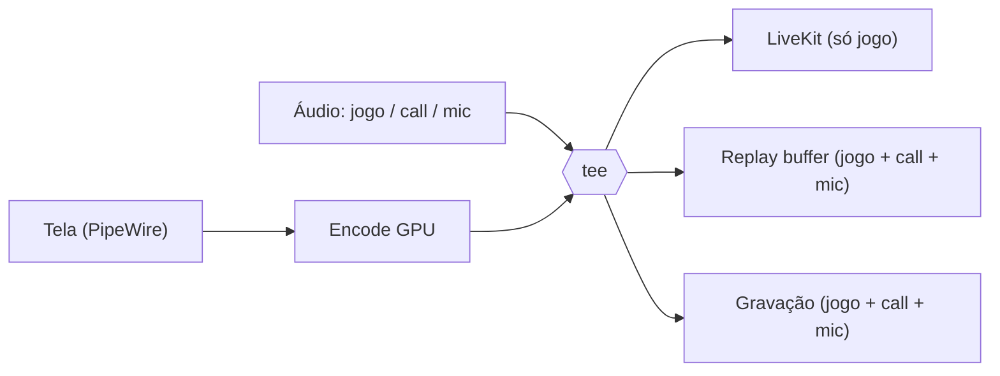

# Luna Stream

Motor nativo e leve para **transmitir, gravar e clipar** a tela, feito para as salas privadas da [Luna](https://lunagg.com.br).

> **Status:** M0 a M4 concluídos, e **App Nativo de Bandeja em Slint (`luna-stream`) entregue na v0.5.0** (< 30 MB RAM ocioso, 0 MB VRAM na GPU). Veja o [ROADMAP](ROADMAP.md), [ADR-0003](docs/adr/0003-toolkit-ui-nativa-slint.md) e o [Guia Manual da UI](docs/testing/slint-ui-manual.md).

## Como Testar

Instale os pré-requisitos listados em [docs/dev-setup.md](docs/dev-setup.md), depois:

### 1. Aplicativo Desktop Nativo (Slint + System Tray)

```bash
# Compilar e iniciar o app nativo (sobe o daemon automaticamente se necessário)
cargo run -p luna-stream-ui

# Ou iniciar minimizado direto na bandeja do sistema
cargo run -p luna-stream-ui -- --minimized
```

- **Controle:** Ligue o Replay Buffer ou inicie a Gravação com 1 clique; salve clipes no botão ou via `ALT+F10`.
- **Galeria:** Assista clipes gravados ou exclua com o botão *Desfazer* (6 segundos).
- **Bandeja:** O ícone reflete o status em tempo real (violeta ocioso, esmeralda replay, carmesim gravação); fechar no `X` apenas recolhe para a bandeja.
- **Zero VRAM em jogo:** Renderizador `winit-software` padrão não aloca contexto na GPU enquanto você joga.

### 2. Controle via Linha de Comando (CLI)

```bash
# 1. Compilar todo o workspace
cargo build --workspace

# 2. Iniciar o daemon em segundo plano
cargo run -p luna-streamd &

# 3. Testar a conexão IPC
cargo run -p luna-streamctl -- ping

# 4. Listar encoders detectados na GPU
cargo run -p luna-streamctl -- encoders

# --- Replay Buffer & Clipes (Marco M4) ---
# Iniciar o buffer circular de replay na RAM (ex: 30s, máx 512MB RAM, com atalho global ALT+F10)
cargo run -p luna-streamctl -- replay start --duration 30 --max-ram 512

# Consultar o status e uso de memória em tempo real
cargo run -p luna-streamctl -- replay status

# Salvar clipe manualmente (ou pressione o atalho global ALT+F10 em qualquer jogo/janela)
cargo run -p luna-streamctl -- replay save

# Parar o buffer de replay
cargo run -p luna-streamctl -- replay stop

# --- Gravação Contínua Anti-Crash (Marco M3) ---
# Iniciar gravação anti-crash contínua (compartilha encode se o replay já estiver ativo!)
cargo run -p luna-streamctl -- record start --format mp4 --quality high

# Consultar status em tempo real (tempo, MB gravados e encoder ativo)
cargo run -p luna-streamctl -- record status

# Finalizar a gravação
cargo run -p luna-streamctl -- record stop

# Flags de gravação disponíveis (start):
# --format <mp4|mkv>                      (padrão: mp4 fragmentado anti-crash)
# --quality <ultra|high|medium|low>       (padrão: high via CQP por hardware)
# --bitrate-kbps <N>                      (bitrate de vídeo explícito)
# --width <W> --height <H>                (redimensionamento via GPU)
# --fps <N>                               (taxa de quadros, padrão: 60)
# --dir <DIR>                             (pasta de saída, padrão: $XDG_VIDEOS_DIR/Luna)
# --game-name <NOME>                      (força nome do jogo no arquivo)
# --no-separate-tracks                    (grava somente a Faixa 1 Mix)
# --audio-mode <isolated|desktop-loopback> (padrão: isolated)
# --mic-device <NOME>                     (seleciona microfone específico)
# --no-audio                              (desativa todo o áudio)
# --no-call                               (desativa áudio do Discord/voz)
# --no-mic                                (desativa microfone)
```

## A ideia

Hoje o `/share` da Luna roda em um cliente Electron que captura e codifica a tela pelo Chromium. Funciona, mas pesa mesmo quando ninguém está assistindo e não grava nem faz clipes.

O Luna Stream é um motor nativo (Rust + GStreamer) que:

- **Transmite** a tela para a sala da Luna via LiveKit, **só com o áudio do jogo** (sem call e sem microfone).
- **Grava** sessões inteiras em arquivo com trilhas de áudio separadas.
- **Faz clipes** com um replay buffer na RAM: aperte uma tecla e os últimos N segundos viram um arquivo, **com o áudio do jogo, da call (Discord) e do microfone**.
- Fica **quase parado quando ocioso** e só gasta recursos ao transmitir, gravar ou assistir outro membro.

Ideia central: **uma captura e um encode na GPU, vários destinos**.



## Plataformas

1. **Linux** primeiro (Wayland e X11; AMD, Intel e NVIDIA).
2. **Windows** só depois que o Linux passar pelo [Gate Linux](ROADMAP.md#m8--gate-linux-100-e-rodando-muito-bem).

## Inspiração

O desenho conceitual se inspira no [gpu-screen-recorder](https://git.dec05eba.com/gpu-screen-recorder/about/) de dec05eba (encode na GPU, replay buffer, captura de áudio por aplicativo). **Nenhum código dele é copiado**; este projeto é uma implementação independente.

## Documentação

- [ROADMAP.md](ROADMAP.md): visão, arquitetura alvo e marcos.
- [docs/adr/](docs/adr/): registros de decisões técnicas.

## Licença

[MIT](LICENSE)

