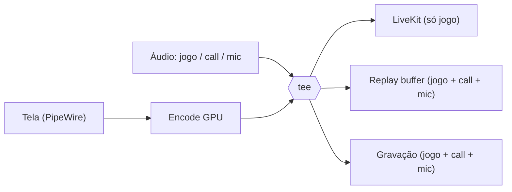

# Luna Stream

Motor nativo e leve para **transmitir, gravar e clipar** a tela, feito para as salas privadas da [Luna](https://lunagg.com.br).

> **Status:** planejamento. Ainda não há código; veja o [ROADMAP](ROADMAP.md).

## A ideia

Hoje o `/share` da Luna roda em um cliente Electron que captura e codifica a tela pelo Chromium. Funciona, mas pesa mesmo quando ninguém está assistindo e não grava nem faz clipes.

O Luna Stream é um motor nativo (Rust + GStreamer) que:

- **Transmite** a tela para a sala da Luna via LiveKit, **só com o áudio do jogo** (sem call e sem microfone).
- **Grava** sessões inteiras em arquivo com trilhas de áudio separadas.
- **Faz clipes** com um replay buffer na RAM: aperte uma tecla e os últimos N segundos viram um arquivo, **com o áudio do jogo, da call (Discord) e do microfone**.
- Fica **quase parado quando ocioso** e só gasta recursos ao transmitir, gravar ou assistir outro membro.

Ideia central: **uma captura e um encode na GPU, vários destinos**.

## Plataformas

1. **Linux** primeiro (Wayland e X11; AMD, Intel e NVIDIA).
2. **Windows** só depois que o Linux passar pelo [Gate Linux](ROADMAP.md#m8--gate-linux-100-e-rodando-muito-bem).

## Inspiração

O desenho conceitual se inspira no [gpu-screen-recorder](https://git.dec05eba.com/gpu-screen-recorder/about/) de dec05eba (encode na GPU, replay buffer, captura de áudio por aplicativo). **Nenhum código dele é copiado**; este projeto é uma implementação independente.

## Documentação

- [ROADMAP.md](ROADMAP.md): visão, arquitetura alvo e marcos.
- [docs/adr/](docs/adr/): registros de decisões técnicas.

## Licença

[MIT](LICENSE)
