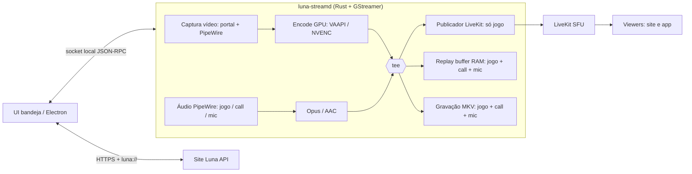

# Luna Stream — Roadmap

> Motor nativo de captura (transmitir, gravar, clipar) para a Luna. Linux primeiro; Windows só depois do Gate Linux.
> Inspiração conceitual: gpu-screen-recorder (sem copiar código).

## Visão final

Um app de bandeja que fica **quase parado** quando ocioso e só gasta recursos ao transmitir, gravar ou assistir alguém.

| Estado | Meta de recursos |
|---|---|
| Ocioso na bandeja | < 30 MB RAM, ~0% CPU, 0% GPU |
| Replay buffer ligado | encode na GPU, < 3% CPU, RAM = tamanho do buffer |
| Transmitindo + buffer | **um único encode** compartilhado |
| Assistindo 1 membro | decode na GPU, só da faixa assinada |

## Princípios

1. **Um encode, vários destinos**: captura → encode GPU → `tee` → LiveKit / replay buffer / arquivo.
2. **Zero-copy** sempre que possível (DMA-BUF do PipeWire → VAAPI/NVENC).
3. **Áudio em trilhas separadas** (jogo, call, mic); cada destino escolhe quais trilhas usa.
4. **Site é a autoridade** de identidade e salas; o app nunca guarda segredo do LiveKit.
5. **LiveKit fica** enquanto não for gargalo — SFU no servidor não pesa no cliente; o cliente nativo publica direto nele.
6. **Motor sem UI**: o motor (`luna-streamd`) expõe uma API local; qualquer UI (Electron hoje, nativa amanhã) é cliente dele.

## Arquitetura alvo

## Marcos

### M0 — Fundação do repositório
- Repo público `luna-stream`, licença, README com a ideia, este roadmap, ADRs.
- Workspace Rust: `luna-streamd` (motor), `luna-stream-proto` (contrato IPC), `luna-streamctl` (CLI de teste).
- CI (build, clippy, testes), releases versionadas.
- **Saída:** `luna-streamctl ping` responde ao motor.

### M1 — Captura de vídeo Linux
- `xdg-desktop-portal` ScreenCast com **restore token** (pede permissão uma vez).
- PipeWire com DMA-BUF; fallback para memória comum; X11 como fallback secundário.
- Detecção de GPU/encoder: VAAPI (AMD/Intel), NVENC (NVIDIA), fallback x264.
- H.264 primeiro; HEVC/AV1 opcionais por detecção.
- **Saída:** `luna-streamctl record --seconds 10` gera vídeo fluido 60 fps.

### M2 — Áudio Linux
- Roteamento nativo no PipeWire (sem processos externos em loop).
- Três fontes: **jogo** (todas as saídas exceto voz), **call** (Discord/Vesktop/etc.), **mic**.
- Trilhas separadas, sincronia A/V, troca de dispositivo a quente.
- **Saída:** gravação MKV com 3 trilhas sincronizadas.

### M3 — Gravação
- MKV/MP4 fragmentado (não corrompe se travar), pasta configurável, nome por data/jogo.
- Trilhas configuráveis (padrão: jogo + call + mic).
- **Saída:** gravação de 2 h sem drift nem perda de frames.

### M4 — Replay buffer / Clipes
- Buffer circular **de pacotes já codificados** (não re-encoda), alinhado em keyframe.
- Duração e limite de RAM configuráveis; hotkey global via portal `GlobalShortcuts`.
- Salvar últimos N s em < 1 s; notificação do sistema.
- **Saída:** clipe de 30 s com áudio da call + mic, gerado por hotkey.

### M5 — Integração com o share-client atual
- Electron fala com o motor pelo socket: botões Clipar / Gravar, status, configurações.
- Electron continua transmitindo via LiveKit (fase de transição).
- Motor distribuído junto ao app (AppImage) e como binário separado.
- **Saída:** usuário da Luna usa clipes/gravação sem instalar nada novo.

### M6 — Transmissão nativa
- Motor publica no LiveKit (SDK Rust ou `livekitwebrtcsink` — decidir por ADR após benchmark).
- Simulcast + parar encode de camadas sem viewers (equivalente ao dynacast).
- **Mesmo encode** alimenta stream, buffer e gravação; stream só com a trilha **jogo**.
- Login pelo navegador + código de conexão alternativo (mesma experiência do app atual; ver [ideias herdadas](docs/plans/2026-11-05-ideias-electron.md)).
- **Criptografia de ponta a ponta (E2EE)** quando a sala exigir, compatível com o site.
- Sessão guardada no cofre de senhas do sistema.
- **Saída:** transmitir + clipar com um único encode; Electron não captura mais nada.

### M7 — UI leve e visualizador sob demanda
- App de bandeja nativo (GTK4 / Slint / egui — ADR) substituindo o Electron no dia a dia.
- Visualizador abre só ao assistir alguém: assinatura manual, decode GPU; ao fechar, libera tudo.
- Electron vira opcional/legado **só depois** de cobrir as [ideias herdadas do app atual](docs/plans/2026-11-05-ideias-electron.md).
- Prévia leve na grade; vídeo completo assinado só ao abrir o palco.
- **Saída:** metas da tabela "Visão final" atingidas e medidas.

### M8 — Gate Linux ("100% e rodando muito bem")
- Matriz testada: GNOME, KDE, Hyprland, Sway × AMD, Intel, NVIDIA × Wayland/X11.
- Soak test de 8 h, reconexão de rede, troca de monitor, suspensão.
- Empacotamento: Flatpak (Flathub), AppImage, `.deb`; auto-update.
- Benchmarks publicados e comparáveis entre versões.
- **Critério para avançar:** tudo verde + uso real pela comunidade sem bugs críticos por N semanas.

### M9 — Windows
- Captura: Windows Graphics Capture (DXGI como fallback).
- Áudio: WASAPI **process loopback** (Win10 2004+) para excluir o Discord do stream e capturá-lo separado para a call.
- Encode: NVENC / AMF / QSV.
- Instalador + auto-update; mesma UI e mesmo contrato IPC.

### M10+ — Futuro distante
- Clipes no site: upload, página de clipes da sala, link de compartilhamento, "mandar clipe na sala".
- Editor rápido: cortar início/fim, escolher trilhas, exportar.
- HDR / 10-bit, AV1 por padrão quando suportado.
- Destaques automáticos (picos de áudio / eventos do jogo).
- Gravar a tela de outro membro **com consentimento** explícito.
- macOS e visualizador mobile (só assistir).

## Fora de escopo (por enquanto)
- Captura KMS com helper setuid (estilo GSR) — só se o portal se mostrar insuficiente.
- Streaming para Twitch/YouTube (RTMP) — possível via `tee`, mas não é objetivo.
- Edição de vídeo avançada.

## Decisões em aberto (ADRs)
| ID | Decisão | Quando |
|---|---|---|
| ADR-1 | Licença do repo — **MIT (aceita)** | M0 |
| ADR-2 | SDK Rust LiveKit vs `livekitwebrtcsink` (critério obrigatório: E2EE) | antes de M6 |
| ADR-3 | Toolkit da UI nativa | antes de M7 |
| ADR-4 | Contrato IPC (JSON-RPC sobre unix socket) | M0 |
