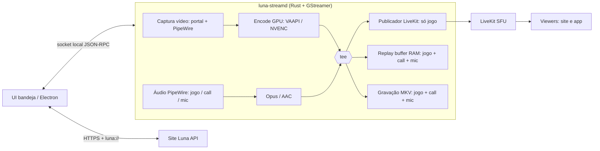

# Luna Stream — Roadmap

> Motor nativo de captura (transmitir, gravar, clipar) para a Luna. Linux primeiro; Windows só depois do Gate Linux.
> Inspiração conceitual: gpu-screen-recorder (sem copiar código).

## Visão final

Um app de bandeja que fica **quase parado** quando ocioso e só gasta recursos ao transmitir, gravar ou assistir alguém.

| Estado | Meta de recursos |
|---|---|
| Ocioso na bandeja | < 30 MB RAM, ~0% CPU, 0% GPU |
| Replay buffer ligado | encode na GPU, < 3% CPU, RAM = tamanho do buffer |
| Transmitindo + buffer | **um único encode** compartilhado |
| Assistindo 1 membro | decode na GPU, só da faixa assinada |

## Princípios

1. **Um encode, vários destinos**: captura → encode GPU → `tee` → LiveKit / replay buffer / arquivo.
2. **Zero-copy** sempre que possível (DMA-BUF do PipeWire → VAAPI/NVENC).
3. **Áudio em trilhas separadas** (jogo, call, mic); cada destino escolhe quais trilhas usa.
4. **Site é a autoridade** de identidade e salas; o app nunca guarda segredo do LiveKit.
5. **LiveKit fica** enquanto não for gargalo — SFU no servidor não pesa no cliente; o cliente nativo publica direto nele.
6. **Motor sem UI**: o motor (`luna-streamd`) expõe uma API local; qualquer UI (Electron hoje, nativa amanhã) é cliente dele.

## Arquitetura alvo

## Marcos

### M0 — Fundação do repositório ✅ (concluído na v0.0.1)
- Repo público `luna-stream`, licença MIT, README com a ideia, este roadmap, ADRs.
- Workspace Rust: `luna-streamd` (motor), `luna-stream-proto` (contrato IPC), `luna-streamctl` (CLI de teste).
- CI (build, clippy, testes), releases versionadas.
- **Saída:** `luna-streamctl ping` responde ao motor (plano executado: [M0 + M1](docs/plans/2026-11-05-m0-m1-fundacao-captura.md)).

### M1 — Captura de vídeo Linux ✅ (concluído na v0.1.0)
- `xdg-desktop-portal` ScreenCast com **restore token** (pede permissão uma vez).
- PipeWire com stream fd nativo.
- Detecção de GPU/encoder: VAAPI (`vah264enc`/`vaapih264enc`), NVENC (`nvh264enc`), fallback software (`openh264enc`/`x264enc`).
- **Saída:** `luna-streamctl record --seconds 10` gera vídeo 1080p60 fluido (validação em hardware real: [Gate M1](docs/testing/m1-manual.md)).

### M2 — Áudio Linux ✅ (concluído na v0.2.0)
- Roteamento nativo no PipeWire e virtual null-sinks sem processos externos em loop.
- Três fontes independentes: **jogo** (todas as saídas de apps/jogos exceto voz), **call** (Discord/Vesktop/WebRTC VoiceEngine), **mic** (dispositivo físico ou padrão).
- Trilhas separadas codificadas em Opus 48kHz, sincronia A/V com do-timestamp e queues dedicadas.
- Sincronização e detecção dinâmica de novos jogos/apps em segundo plano via `audio::router`.
- Suporte a modo isolado (`isolated`) ou monitor geral do desktop (`desktop-loopback`).
- **Saída:** gravação MKV com 1 vídeo H.264 + 3 trilhas Opus sincronizadas (validação em hardware real: [Gate M2](docs/testing/m2-manual.md), plano executado: [M2](docs/plans/2026-11-06-m2-audio-linux.md)).

### M3 — Gravação Longa e Fragmentada Anti-Crash ✅ (concluído na v0.3.0)
- Containers anti-crash: MP4 fragmentado (`mp4mux fragment-duration=1000` + AAC) e MKV clusterizado (`matroskamux min-cluster-duration=500000000 offset-to-zero=true` + Opus).
- Tolerância total a crash violento (`kill -9`/queda de energia): reproduzível no `ffprobe` e `Discoverer` sem corromper.
- Layout de áudio padrão OBS: Trilha 1 = Mixagem Master completa (`audiomixer`); Trilhas 2, 3 e 4 = faixas isoladas (Jogo, Call, Mic).
- Presets de qualidade CQP (`ultra` [18], `high` [23], `medium` [28], `low` [33]), bitrate explícito e escala GPU opcional (`vapostproc`).
- Resolução automática de diretório (`$XDG_VIDEOS_DIR/Luna`) e nome por data/jogo do PipeWire (`YYYY-MM-DD_HH-MM-SS_<Jogo>.<ext>`) com sanitização e verificação de espaço livre em disco (mínimo 1 GB).
- Controle assíncrono via `record.start`, `record.status` (progresso em tempo real) e `record.stop`.
- Subcomandos completos no `luna-streamctl`: `record start`, `record status`, `record stop` e flags avançadas.
- **Saída:** validação anti-crash com `kill -9` aprovada, teste em hardware real Intel VA-API com fMP4 e MKV (relatório: [Gate M3](docs/testing/m3-manual.md), especificação: [Design M3](docs/superpowers/specs/2026-11-06-m3-recording-design.md), plano: [Plano M3](docs/superpowers/plans/2026-11-06-m3-recording-plan.md)).

### M4 — Replay buffer / Clipes ✅ (concluído na v0.4.0)
- Buffer circular em RAM (`ReplayRingBuffer`) **de pacotes já codificados** (zero re-encode), alinhado em keyframe de vídeo.
- Duração e limite de RAM configuráveis com duplo descarte seguro (sempre retendo o GOP mais recente).
- Atalho global via portal Wayland `GlobalShortcuts` (`ALT+F10`), desacoplado de foco de janela ou jogo.
- Notificações nativas do sistema com link para o arquivo salvo (`NotificationProxy`).
- Escrita rápida de clipes em tempo recorde (< 1 s na velocidade do SSD) em diretório dedicado (`$XDG_VIDEOS_DIR/Luna/Clips/`).
- Sessão compartilhada (`CaptureSession`): um único encode na GPU compartilhado entre gravação e replay simultâneos.
- Subcomandos completos no `luna-streamctl`: `replay start`, `replay save`, `replay status`, `replay stop`.
- **Saída:** clipes salvos em < 1s com layout OBS (Mix + Game + Call + Mic), disparados por atalho global e com sessão única (relatório: [Gate M4](docs/testing/m4-manual.md), especificação: [Design M4](docs/superpowers/specs/2026-11-06-m4-replay-buffer-design.md), plano: [Plano M4](docs/superpowers/plans/2026-11-06-m4-replay-buffer-plan.md)).

### M5 — Integração com o share-client atual
- Electron fala com o motor pelo socket: botões Clipar / Gravar, status, configurações.
- Electron continua transmitindo via LiveKit (fase de transição).
- Motor distribuído junto ao app (AppImage) e como binário separado.
- **Saída:** usuário da Luna usa clipes/gravação sem instalar nada novo.

### M6 — Transmissão nativa
- Motor publica no LiveKit (SDK Rust ou `livekitwebrtcsink` — decidir por ADR após benchmark).
- Simulcast + parar encode de camadas sem viewers (equivalente ao dynacast).
- **Mesmo encode** alimenta stream, buffer e gravação; stream só com a trilha **jogo**.
- Login pelo navegador + código de conexão alternativo (mesma experiência do app atual; ver [ideias herdadas](docs/plans/2026-11-05-ideias-electron.md)).
- **Criptografia de ponta a ponta (E2EE)** quando a sala exigir, compatível com o site.
- Sessão guardada no cofre de senhas do sistema.
- **Saída:** transmitir + clipar com um único encode; Electron não captura mais nada.

### M7 — UI leve e visualizador sob demanda
- App de bandeja nativo (GTK4 / Slint / egui — ADR) substituindo o Electron no dia a dia.
- Visualizador abre só ao assistir alguém: assinatura manual, decode GPU; ao fechar, libera tudo.
- Electron vira opcional/legado **só depois** de cobrir as [ideias herdadas do app atual](docs/plans/2026-11-05-ideias-electron.md).
- Prévia leve na grade; vídeo completo assinado só ao abrir o palco.
- **Saída:** metas da tabela "Visão final" atingidas e medidas.

### M8 — Gate Linux ("100% e rodando muito bem")
- Matriz testada: GNOME, KDE, Hyprland, Sway × AMD, Intel, NVIDIA × Wayland/X11.
- Soak test de 8 h, reconexão de rede, troca de monitor, suspensão.
- Empacotamento: Flatpak (Flathub), AppImage, `.deb`; auto-update.
- Benchmarks publicados e comparáveis entre versões.
- **Critério para avançar:** tudo verde + uso real pela comunidade sem bugs críticos por N semanas.

### M9 — Windows
- Captura: Windows Graphics Capture (DXGI como fallback).
- Áudio: WASAPI **process loopback** (Win10 2004+) para excluir o Discord do stream e capturá-lo separado para a call.
- Encode: NVENC / AMF / QSV.
- Instalador + auto-update; mesma UI e mesmo contrato IPC.

### M10+ — Futuro distante
- Clipes no site: upload, página de clipes da sala, link de compartilhamento, "mandar clipe na sala".
- Editor rápido: cortar início/fim, escolher trilhas, exportar.
- HDR / 10-bit, AV1 por padrão quando suportado.
- Destaques automáticos (picos de áudio / eventos do jogo).
- Gravar a tela de outro membro **com consentimento** explícito.
- macOS e visualizador mobile (só assistir).

## Fora de escopo (por enquanto)
- Captura KMS com helper setuid (estilo GSR) — só se o portal se mostrar insuficiente.
- Streaming para Twitch/YouTube (RTMP) — possível via `tee`, mas não é objetivo.
- Edição de vídeo avançada.

## Decisões em aberto (ADRs)
| ID | Decisão | Quando |
|---|---|---|
| ADR-1 | Licença do repo — **MIT (aceita)** | M0 |
| ADR-2 | SDK Rust LiveKit vs `livekitwebrtcsink` (critério obrigatório: E2EE) | antes de M6 |
| ADR-3 | Toolkit da UI nativa | antes de M7 |
| ADR-4 | Contrato IPC (JSON-RPC sobre unix socket) | M0 |
