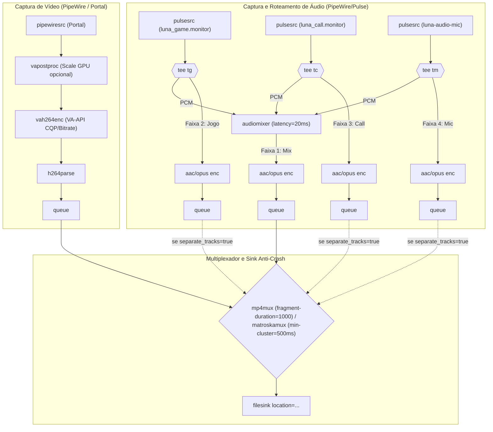

# M3 — Gravação Longa e Fragmentada Anti-Crash — Design Document

## 1. Visão Geral e Objetivos

O marco **M3** expande o motor `luna-stream` para oferecer gravação local de alta qualidade e longa duração (2h+ contínuas) sem limites impostos pelo servidor de streaming (M6), com as seguintes propriedades essenciais:

1. **À prova de crash (`SIGKILL` / queda de energia):** Gravação em container fragmentado que pode ser interrompido a qualquer momento sem perder os minutos ou horas já gravados.
2. **Layout de Áudio Padrão OBS:** Trilha 1 sempre com a mixagem completa (Jogo + Call + Microfone) para tocar imediatamente em qualquer player comum, Discord e celular, acompanhada de Trilhas 2, 3 e 4 isoladas para edição (opcionalmente desativáveis via configuração).
3. **Containers Flexíveis:** Suporte nativo a `.mp4` fragmentado (H.264 + AAC) como padrão de máxima compatibilidade, e `.mkv` clusterizado (H.264 + Opus).
4. **Pasta Configurável e Nome Automático:** Geração automática do arquivo baseada em data/hora e nome do jogo detectado dinamicamente no PipeWire (`YYYY-MM-DD_HH-MM-SS_<Jogo_ou_Desktop>.<ext>`), ou caminho explícito.
5. **Qualidade Sem Limites de Servidor:** Resolução livre (nativa ou escalada via GPU), taxa de quadros customizável (30, 60, 120 fps) e controle de qualidade via CQP (`low`, `medium`, `high`, `ultra`) ou bitrate explícito.
6. **Controle Assíncrono no Daemon:** Métodos IPC `record.start`, `record.status` e `record.stop`, permitindo gravações contínuas gerenciadas por qualquer UI ou CLI.

---

## 2. Arquitetura do Pipeline



### 2.1 Containers Anti-Crash
- **Fragmented MP4 (`mp4mux fragment-duration=1000`):**
  - Escreve fragmentos `moof`/`mdat` a cada 1 segundo.
  - Se o processo for encerrado forçadamente (`kill -9`), queda de energia ou travamento do sistema, todos os fragmentos gravados até o último segundo continuam 100% íntegros e reproduzíveis sem necessidade de reparo.
  - Áudio codificado em AAC (`fdkaacenc` ou `avenc_aac` com `aacparse`).
- **Clusterized Matroska (`matroskamux min-cluster-duration=500000000 offset-to-zero=true`):**
  - Cria clusters a cada 500ms. O MKV por especificação não exige átomo `moov` no final do arquivo para reprodução sequencial.
  - Áudio codificado em Opus (`opusenc`).

### 2.2 Layout de Áudio (OBS Standard)
1. **Trilha 1 (Master Mix):** Mixagem em tempo real de todas as fontes habilitadas (`game`, `call`, `microphone`) usando `audiomixer latency=20000000`. Essa faixa é o stream de áudio padrão reproduzido automaticamente por qualquer reprodutor ou ao compartilhar no Discord/WhatsApp.
2. **Trilha 2 (Jogo / Aplicações):** Áudio estéreo isolado de jogos e aplicativos.
3. **Trilha 3 (Call / Voz):** Áudio estéreo isolado de Discord / Vesktop / WebRTC VoiceEngine.
4. **Trilha 4 (Microfone):** Áudio do microfone do jogador.
- Se `AudioConfig.separate_tracks == false`, apenas a Trilha 1 (Mix) é codificada e gravada, reduzindo bitrate e tamanho de arquivo.

---

## 3. Nomeação Automática e Detecção de Jogo

Quando `output` não for um caminho completo com nome de arquivo:
1. Diretório base resolvido:
   - Campo `output_dir` (se informado);
   - `$XDG_VIDEOS_DIR/Luna` (se `$XDG_VIDEOS_DIR` estiver definido);
   - Fallback para `~/Videos/Luna` ou `~/Vídeos/Luna`.
2. Criação automática de diretórios pai se não existirem.
3. Identificação do Nome do Jogo:
   - Se `game_name` for fornecido na requisição IPC, utiliza este nome.
   - Caso contrário, o `audio::router` analisa o grafo do PipeWire: localiza o nó ativo com `media.class == "Stream/Output/Audio"` classificado como `StreamCategory::Game`.
   - Extrai `application.name` (ex.: `"Counter-Strike 2"`, `"Dota 2"`).
   - Se nenhum jogo estiver com áudio ativo, usa `"Desktop"`.
   - Sanitização de caracteres proibidos em caminhos (`/`, `\`, `:`, `*`, `?`, `"`, `<`, `>`, `|`, espaços convertidos em `_`).
4. Nome final gerado:
   `YYYY-MM-DD_HH-MM-SS_<Nome_Sanitizado>.<mp4|mkv>` (ex.: `2026-11-06_19-30-00_Counter-Strike_2.mp4`).

---

## 4. Contrato IPC (`luna-stream-proto`)

### 4.1 Novos Tipos e Extensões

```rust
#[derive(Debug, Clone, Copy, Serialize, Deserialize, PartialEq, Eq, Default)]
#[serde(rename_all = "snake_case")]
pub enum ContainerFormat {
    #[default]
    Mp4,
    Mkv,
}

#[derive(Debug, Clone, Copy, Serialize, Deserialize, PartialEq, Eq, Default)]
#[serde(rename_all = "snake_case")]
pub enum QualityPreset {
    Ultra,   // CQP 18 (Arquivamento e edição de altíssima fidelidade)
    #[default]
    High,    // CQP 23 (Equilíbrio ótimo qualidade/tamanho)
    Medium,  // CQP 28 (Uso econômico de espaço)
    Low,     // CQP 33 (Gravações muito longas em discos menores)
}

#[derive(Debug, Clone, Serialize, Deserialize, PartialEq, Default)]
pub struct VideoRecordConfig {
    pub width: Option<u32>,
    pub height: Option<u32>,
    pub quality: QualityPreset,
    pub bitrate_kbps: Option<u32>, // Se informado, usa CBR/VBR ao invés de CQP
}

// Extensão de AudioConfig:
// pub separate_tracks: bool (default: true)

#[derive(Debug, Clone, Serialize, Deserialize, PartialEq)]
pub struct RecordStartParams {
    pub output: Option<PathBuf>,
    pub output_dir: Option<PathBuf>,
    pub game_name: Option<String>,
    #[serde(default)]
    pub format: ContainerFormat,
    #[serde(default)]
    pub source: SourceKind,
    #[serde(default = "default_fps")]
    pub fps: u32,
    #[serde(default)]
    pub video: VideoRecordConfig,
    #[serde(default)]
    pub audio: AudioConfig,
}

#[derive(Debug, Clone, Serialize, Deserialize, PartialEq)]
pub struct RecordStatusResult {
    pub recording: bool,
    pub path: Option<PathBuf>,
    pub duration_ms: u64,
    pub bytes_written: u64,
    pub encoder: Option<String>,
    pub format: Option<ContainerFormat>,
}
```

### 4.2 Novos Métodos JSON-RPC
- `record.start`: Inicia a gravação (valida disco livre >= 1 GB, cria diretórios, resolve nome, inicializa áudio e pipeline). Retorna `RecordStartResult { encoder, path, format }`.
- `record.status`: Retorna estado atual, tempo decorrido e tamanho estimado do arquivo.
- `record.stop`: Finaliza graciosamente enviando EOS e desfazendo virtual sinks. Retorna `RecordStopResult { path, duration_ms, bytes_written }`.

---

## 5. Interface de Linha de Comando (`luna-streamctl`)

O subcomando `record` passará a suportar os fluxos assíncronos e os parâmetros avançados:
- `luna-streamctl record --seconds 10` (atalho síncrono para gravações rápidas mantido)
- `luna-streamctl record start [--output PATH] [--dir DIR] [--format mp4|mkv] [--quality high|ultra|medium|low] [--bitrate-kbps N] [--width W --height H] [--no-separate-tracks] ...`
- `luna-streamctl record status`
- `luna-streamctl record stop`

---

## 6. Tratamento de Erros e Casos de Borda

1. **Disco cheio durante gravação longa:** O barramento GStreamer monitora mensagens de erro do `filesink` (`ENOSPC`); ao detectar, interrompe graciosamente sem corromper os fragmentos já salvos e emite log/status.
2. **Espaço livre insuficiente no início:** Verificação prévia exige no mínimo 1 GB livre na partição de destino antes de iniciar (`ErrorCode::OutputNotWritable` ou novo `ErrorCode::DiskFull`).
3. **Múltiplos jogos abertos simultaneamente:** O `audiomixer` soma com mixagem proporcional sem clipping analógico; a trilha 2 recebe todas as saídas de jogos combinadas.
4. **Fechamento repentino com `SIGKILL`:** O teste de regressão automatizado executará `kill -9` no processo durante gravação de fMP4 e validará via `ffprobe` que o arquivo final continua abrindo e reproduzindo os fragmentos gravados.

---

## 7. Critérios de Aceite e Homologação (Gate M3)

- Suíte de testes automatizados completa (`cargo test --workspace`) cobrindo:
  - Geração e sanitização de nomes de arquivos com detecção de jogo.
  - Gravação fMP4 com AAC multi-trilha (Mix + separadas).
  - Gravação MKV com Opus multi-trilha.
  - Teste de `SIGKILL` (interrupção forçada) comprovando a integridade dos fragmentos fMP4.
  - Métodos `record.start`, `record.status` e `record.stop`.
- Homologação em hardware real gravando sessão de tela com jogo e voz, inspecionando integridade de tracks e codecs com `ffprobe`.
- Tag de versão `v0.3.0` publicada no repositório.
