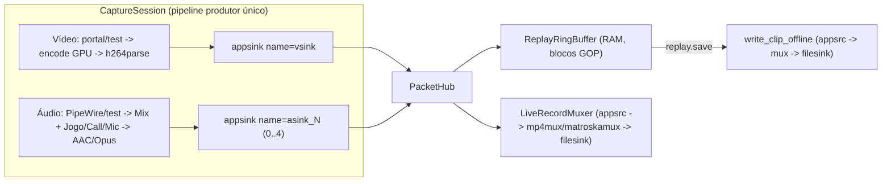

# M4 — Replay Buffer em RAM e Clipes por Atalho Global — Design Document

## 1. Visão Geral e Objetivos

O M4 adiciona ao `luna-streamd` um **replay buffer em RAM** com pacotes já codificados e o salvamento instantâneo de clipes, por atalho global ou por IPC/CLI. Ele também reestrutura a captura para cumprir o princípio **"um encode, vários destinos"**: replay e gravação contínua passam a compartilhar a mesma captura e o mesmo encode na GPU.

### Decisões de produto (confirmadas com o usuário)

| Tema | Decisão |
|---|---|
| Replay + Gravação | **Encode único compartilhado já no M4.** O Replay pode ficar ligado em segundo plano enquanto gravações começam e terminam na mesma sessão, sem segundo encode e sem reabrir o portal. |
| Pasta dos clipes | `$XDG_VIDEOS_DIR/Luna/Clips/Clip_YYYY-MM-DD_HH-MM-SS_<Jogo>.<ext>` (com sufixo `_2`, `_3`… em caso de colisão). |
| Comportamento após salvar | **Janela deslizante por padrão:** o buffer não é limpo, e dois clipes seguidos podem se sobrepor. Há a opção explícita `clear_after_save` / `--clear` para limpar o buffer depois de salvar e liberar memória. |
| Áudio | Mesmo layout OBS do M3: Trilha 1 = Mix Master; Trilhas 2–4 = Jogo, Call, Mic isoladas. Clipes locais incluem todas as fontes escolhidas pelo usuário. |

### Fora de escopo no M4

- Publicação no LiveKit (M6). O `PacketHub` fica pronto para receber um terceiro consumidor, mas nenhum publicador é implementado agora.
- UI e integração com o Electron (M5).
- Edição ou corte de clipes (M10+).
- Mudar encoder, resolução ou fps de uma sessão já ativa.

## 2. Arquitetura



Nova dependência: `gstreamer-app = "0.23"` (MIT/Apache-2.0, do mesmo projeto `gstreamer-rs` já usado), para `appsink`/`appsrc`. O plugin `app` vem do `gst-plugins-base` e já está presente no sistema de referência.

### 2.1 `session.rs` — `CaptureSession` e `PacketHub`

- A `CaptureSession` é dona de `PortalSession` (quando `source=screen`), `AudioRouter` (modo `isolated`) e do `gst::Pipeline` produtor.
- Ela existe enquanto **pelo menos um** consumidor estiver ativo (`replay` ou `record`) e é encerrada automaticamente quando os dois param.
- O pipeline produtor é descrito por `describe_producer(...)` em `pipeline.rs`. Essa função reutiliza os mesmos blocos de fonte, encoder (`enc_part`) e áudio (`audio_track_encoder`, `audiomixer`) de `describe_record`, mas cada ramo termina em `appsink`, sem muxer:
  - Vídeo: `... ! h264parse config-interval=-1 ! video/x-h264,stream-format=avc,alignment=au ! appsink name=vsink`.
  - Áudio: `... ! appsink name=asink_mix`, `asink_game`, `asink_call`, `asink_mic`, criando só os ramos habilitados em `AudioConfig`.
  - Todos os `appsink` usam `sync=false`, `emit-signals=false` e callbacks `new_sample` que não bloqueiam.
- Cada amostra vira um `EncodedPacket { track: TrackId, buffer: gst::Buffer, caps: gst::Caps }`. `gst::Buffer` e `gst::Caps` usam contagem de referência atômica, então os bytes **não são copiados** ao distribuir.
- O `PacketHub` entrega cada pacote ao `ReplayRingBuffer` (se ativo) e ao `LiveRecordMuxer` (se ativo).
- Um keyframe é um buffer de vídeo sem a flag `DELTA_UNIT`. O GOP continua `fps * 2` (keyframe a cada 2 s), igual ao M1–M3.
- **Codec de áudio da sessão:** é definido pelo `format` do primeiro consumidor (`mp4` → AAC, `mkv` → Opus). O container é escolhido por destino: `mp4mux` aceita `audio/x-opus` e `matroskamux` aceita AAC raw (verificado com `gst-inspect-1.0` no GStreamer 1.28.8).

### 2.2 `replay_buffer.rs` — `ReplayRingBuffer`

Estrutura pura em Rust, que pode ser testada sem pipeline:

```rust
pub struct ReplayRingBuffer {
    segments: VecDeque<GopSegment>,
    pending_audio: Vec<EncodedPacket>, // áudio recebido antes do 1º keyframe
    max_duration: gst::ClockTime,
    max_bytes: u64,
    ram_bytes: u64,
}

pub struct GopSegment {
    start_pts: gst::ClockTime,     // PTS do keyframe de vídeo que abre o GOP
    packets: Vec<EncodedPacket>,   // vídeo + áudio, na ordem de chegada
    bytes: u64,
}
```

- `push(packet)`:
  - Um keyframe de vídeo abre um novo `GopSegment`.
  - Os demais pacotes entram no segmento atual.
  - Pacotes que chegam antes do primeiro keyframe são descartados.
- **Duplo limite:** depois de cada `push`, GOPs inteiros são removidos do início (`pop_front`) enquanto `duração > max_duration` **ou** `ram_bytes > max_bytes`. O último GOP **completo** nunca é removido.
- `snapshot(last: Option<Duration>) -> Result<ClipSnapshot, ReplayError>`:
  - Seleciona os GOPs finais que cobrem `last` (ou o buffer inteiro).
  - Clona apenas as referências e devolve também o índice do último GOP incluído.
  - Não faz I/O enquanto segura o lock.
- `clear_through(snapshot_end)`: remove os GOPs até o fim do snapshot e preserva os que chegaram depois. É chamado só depois que o clipe foi gravado com sucesso.
- `status() -> (buffered_ms, ram_bytes)`.
- Fica dentro de um `std::sync::Mutex`, com seções críticas de microssegundos.

### 2.3 `muxer.rs` — `write_clip_offline` e `LiveRecordMuxer`

**`write_clip_offline(snapshot, format, path)`**:
- Pipeline **não-live**: um `appsrc` por trilha (`format=time`, `is-live=false`, caps vindas do primeiro pacote) → `mp4mux`/`matroskamux` (mesmas propriedades anti-crash do M3) → `filesink buffer-mode=unbuffered`.
- O PTS/DTS é ajustado subtraindo o `start_pts` do primeiro GOP, para o clipe começar em `00:00.000`. O áudio com PTS anterior a esse início é descartado.
- Os buffers são empurrados sem esperar o relógio, seguidos de `end-of-stream` em cada `appsrc`. A função espera EOS no bus com timeout de 5 s.
- Roda em `tokio::task::spawn_blocking`. Meta: menos de 1 s para 30 s de 1080p60.

**`LiveRecordMuxer`**:
- É criado por `record.start` e assina o `PacketHub`.
- Ao iniciar, envia `UpstreamForceKeyUnitEvent` (`all-headers=true`) ao encoder e descarta os pacotes até o primeiro keyframe. O PTS desse keyframe vira a origem `00:00`.
- Monta `appsrc` (live, `format=time`) por trilha → muxer M3 (`mp4mux fragment-duration=1000` ou `matroskamux min-cluster-duration=500000000 offset-to-zero=true`) → `filesink buffer-mode=unbuffered`.
- O `appsrc` tem limite de cerca de 2 s de dados (`max-time`/`max-bytes`). Se o limite estourar, a gravação é encerrada com erro explícito, sem descartar quadros em silêncio.
- `record.stop` envia EOS só para esse muxer, sem afetar a sessão nem o replay.
- `record.status` continua com os mesmos campos do M3. `duration_ms` e `bytes_written` são medidos no muxer.

### 2.4 `hotkey.rs` — atalho global e notificação

- **Atalho:**
  - Usa o `ashpd::desktop::global_shortcuts` (já disponível no `ashpd 0.10.3`).
  - `create_session` → `bind_shortcuts([NewShortcut::new("save_clip", "Salvar clipe").preferred_trigger("ALT+F10")])` → tarefa tokio escutando `receive_activated()`.
  - Na ativação, executa o mesmo caminho de `replay.save` com os padrões.
- Antes de criar a sessão, quando o daemon não está em sandbox, tenta registrar o app id `br.com.lunagg.LunaStream` via `org.freedesktop.host.portal.Registry.Register`. Esse serviço existe no KDE do sistema de referência. Se o registro falhar, o daemon segue sem ele.
- **Notificação:** depois de cada salvamento (atalho ou IPC), envia pelo `ashpd::desktop::notification` a mensagem "Clipe salvo" com o nome do arquivo, ou "Falha ao salvar clipe" com o motivo.
- **Atalho e notificação não são críticos:** se falharem, o replay continua funcionando pelo IPC/CLI, `hotkey_bound=false` e o problema fica registrado com `warn!`.
- A sessão do atalho é fechada em `replay.stop`.

### 2.5 Mudanças em código existente

- `pipeline.rs`: extrair os blocos compartilhados de `describe_record` para que `describe_producer` os reutilize, mantendo os testes de string atuais passando.
- `recorder.rs`: o `Recorder` passa a ser uma fachada sobre `CaptureSession` + `LiveRecordMuxer`, preservando `start_record`/`status`/`stop` e `validate_output`.
- `handlers.rs`: o `Daemon` passa a ter `session: Mutex<Option<CaptureSession>>` no lugar de `recorder` + `portal_session` separados. Os métodos `record.*` e `replay.*` usam essa sessão. `shutdown` encerra a gravação com EOS e descarta o replay.
- `naming.rs`: `resolve_clip_path(...)`, com o prefixo `Clip_`, a subpasta `Clips/`, o sufixo `_N` em caso de colisão e `check_free_space` com mínimo = tamanho estimado do snapshot + 64 MiB.

## 3. Contrato IPC (`luna-stream-proto`)

### 3.1 Novos métodos

| Método | Parâmetros | Resultado |
|---|---|---|
| `replay.start` | `ReplayStartParams` | `ReplayStartResult` |
| `replay.save` | `ReplaySaveParams` | `ReplaySaveResult` |
| `replay.status` | — | `ReplayStatusResult` |
| `replay.stop` | — | `ReplayStopResult` |

```rust
pub struct ReplayStartParams {
    #[serde(default)] pub source: SourceKind,
    #[serde(default = "default_fps")] pub fps: u32,
    #[serde(default)] pub video: VideoRecordConfig,
    #[serde(default)] pub audio: AudioConfig,
    #[serde(default)] pub format: ContainerFormat,          // define o codec de áudio se abrir a sessão
    #[serde(default = "default_replay_secs")] pub duration_secs: u32, // 30, faixa 5..=600
    #[serde(default = "default_replay_ram_mb")] pub max_ram_mb: u32,  // 512, mínimo 64
    #[serde(default = "default_true")] pub hotkey: bool,
}

pub struct ReplayStartResult {
    pub encoder: String,
    pub duration_secs: u32,
    pub max_ram_mb: u32,
    pub shared_session: bool,
    pub hotkey_bound: bool,
    #[serde(default, skip_serializing_if = "Option::is_none")] pub hotkey_trigger: Option<String>,
}

pub struct ReplaySaveParams {
    #[serde(default, skip_serializing_if = "Option::is_none")] pub last_secs: Option<u32>,
    #[serde(default)] pub clear_after_save: bool,
    #[serde(default)] pub format: ContainerFormat,
    #[serde(default, skip_serializing_if = "Option::is_none")] pub output_dir: Option<PathBuf>,
    #[serde(default, skip_serializing_if = "Option::is_none")] pub game_name: Option<String>,
}

pub struct ReplaySaveResult {
    pub path: PathBuf,
    pub duration_ms: u64,
    pub bytes_written: u64,
    pub elapsed_ms: u64,
}

pub struct ReplayStatusResult {
    pub active: bool,
    #[serde(default)] pub buffered_ms: u64,
    #[serde(default)] pub ram_bytes: u64,
    #[serde(default)] pub duration_secs: u32,
    #[serde(default)] pub max_ram_mb: u32,
    #[serde(default, skip_serializing_if = "Option::is_none")] pub encoder: Option<String>,
    #[serde(default)] pub hotkey_bound: bool,
    #[serde(default, skip_serializing_if = "Option::is_none")] pub last_error: Option<String>,
}

pub struct ReplayStopResult {
    pub discarded_ms: u64,
}
```

Extensões compatíveis em tipos existentes:
- `RecordStartResult.shared_session: bool` (`#[serde(default)]`).
- `RecordStatusResult.last_error: Option<String>`.

### 3.2 Novos códigos de erro

| Código | Nome | Quando |
|---|---|---|
| 1008 | `already_replaying` | `replay.start` com replay já ativo |
| 1009 | `not_replaying` | `replay.save`/`replay.stop` sem replay ativo |
| 1010 | `replay_empty` | `replay.save` antes do primeiro GOP completo |

Parâmetros fora da faixa (`duration_secs`, `max_ram_mb`, `last_secs = 0`) retornam `InvalidParams`.

### 3.3 Regras de coexistência

1. **A sessão nasce com o primeiro consumidor.** `replay.start` ou `record.start` abre o portal, o roteador de áudio e o encode com os seus próprios parâmetros.
2. **O segundo consumidor reaproveita a sessão.** Ele herda fonte, fps, qualidade, escala e áudio já ativos e não gera um segundo encode. A resposta traz `shared_session: true`, e o CLI avisa quando os parâmetros pedidos diferem dos efetivos. **A chamada não falha por divergência.**
3. **Container por destino, codec por sessão** (ver 2.1).
4. **Parar um consumidor não afeta o outro.** A sessão fecha quando nenhum dos dois está ativo.
5. **`shutdown` do daemon:** a gravação recebe EOS e espera até 5 s; o buffer é descartado e a sessão de atalho é fechada.

## 4. CLI (`luna-streamctl`)

```
luna-streamctl replay start  [--duration 30] [--max-ram 512] [--no-hotkey] [--format mp4|mkv]
                             [--source screen|test] [--fps N] [--quality ...] [--scale WxH] [flags de áudio do record]
luna-streamctl replay save   [--last N] [--clear] [--format mp4|mkv] [--dir <pasta>] [--game-name <nome>]
luna-streamctl replay status
luna-streamctl replay stop
```

O formato segue o padrão de `record` em `cli.rs`: enum `ReplaySubcommand` em `Box` quando for grande (clippy `large_enum_variant`).

## 5. Tratamento de Erros e Casos de Borda

| Situação | Comportamento |
|---|---|
| Erro no pipeline produtor (bus `Error`, portal revogado, fim do stream PipeWire) | A sessão é marcada como falha: EOS no `LiveRecordMuxer` (o arquivo continua tocável), replay encerrado, `last_error` preenchido nos dois `status` e notificação enviada. |
| Falha ao escrever o clipe (disco cheio, sem permissão) | O erro volta em `replay.save` e o buffer fica intacto. `clear_after_save` só se aplica depois do sucesso. |
| Pouco espaço livre | `OutputNotWritable` antes de abrir o pipeline offline. |
| `replay.save` antes do 1º keyframe | `replay_empty`. |
| Atalho pressionado várias vezes seguidas | Os salvamentos são feitos em fila por um `tokio::sync::Mutex`, e cada um gera seu próprio arquivo (`_2`, `_3`…). |
| Disco lento na gravação contínua | Limite de cerca de 2 s no `appsrc`. Se estourar, a gravação é encerrada com erro explícito e `last_error` é preenchido. |
| `max_ram_mb` menor que um GOP | O buffer mantém sempre o último GOP completo. O mínimo validado é 64 MiB. |
| Áudio antes do keyframe inicial do recorte | É descartado para preservar a sincronia A/V a partir de 00:00. |
| Portal `GlobalShortcuts`/`Notification` indisponível | `warn!` e `hotkey_bound=false`. O replay funciona normalmente. |

## 6. Estratégia de Testes (TDD)

1. **Unitários do `ReplayRingBuffer`** com `gst::Buffer` sintéticos: descarte por tempo, descarte por RAM, alinhamento em keyframe, `snapshot(last)`, `clear_through` preservando GOPs novos, `ReplayEmpty` e contagem de `ram_bytes`.
2. **Protocolo** (`tests/wire.rs` / novo `tests/replay_proto.rs`): serialização e padrões dos novos tipos e retrocompatibilidade dos campos novos em `RecordStartResult`/`RecordStatusResult`.
3. **`describe_producer`**: testes de string (`appsink` nomeados, caps `avc`/`au`, ramos de áudio por `AudioConfig`), no padrão de `tests/pipeline.rs`. Os testes atuais de `describe_record` continuam passando.
4. **Integração com `source=test`** (videotestsrc + audiotestsrc + encoder por software via `LUNA_STREAM_ENCODER`):
   - `replay start` → espera de cerca de 6 s → `replay save`. O `ffprobe` deve mostrar 1 vídeo + 4 áudios, início em 0, primeiro quadro keyframe, duração compatível com `buffered_ms` e `elapsed_ms < 1000`.
   - **Coexistência:** `replay start` → `record start` (`shared_session=true`) → `record stop` → `replay save` ainda funciona → `replay stop` → sessão encerrada (`record.status` e `replay.status` inativos).
   - **Limite de RAM:** `duration_secs=600`, `max_ram_mb=64` → `ram_bytes ≤ 64 MiB` depois de alguns segundos.
   - `clear_after_save=true` → `buffered_ms` cai logo depois do save.
5. **Regressão do M3:** todos os testes existentes de gravação, incluindo `crash_resistance.rs` (`kill -9`), passam pelo novo caminho `LiveRecordMuxer`.
6. **CLI:** `tests/replay_cli.rs` cobrindo `replay start/save/status/stop`.
7. **Anti-travamento (obrigatório):** todo teste de integração envolve suas esperas em `tokio::time::timeout` ou `bus.timed_pop_filtered` com limite rígido. Um travamento vira falha com mensagem clara, nunca um `cargo test` preso.

## 7. Critérios de Aceite (Gate M4 — `docs/testing/m4-manual.md`)

- Hardware de referência: Intel Iris Xe (`vah264enc`), KDE Plasma Wayland, PipeWire 1.6.
- `replay start` com captura de tela; o atalho `save_clip` é confirmado no diálogo do KDE e, ao pressioná-lo, gera um clipe de 30 s com **áudio do jogo, da call e do mic** e uma notificação do sistema.
- Tempo de salvamento < 1 s, medido por `elapsed_ms`.
- Replay ligado + `record start/stop` sem segundo encode: um único encoder ativo no `intel_gpu_top` ou no grafo de pipeline.
- Com o replay ligado (1080p60, 30 s): CPU do daemon < 3% e RSS ≈ tamanho do buffer + overhead base.
- `kill -9` durante a gravação compartilhada continua gerando um arquivo tocável.
- `cargo test --workspace`, `cargo clippy --workspace --all-targets -- -D warnings` e `cargo fmt --all --check` sem erros nem avisos.
- Release `v0.4.0`.
