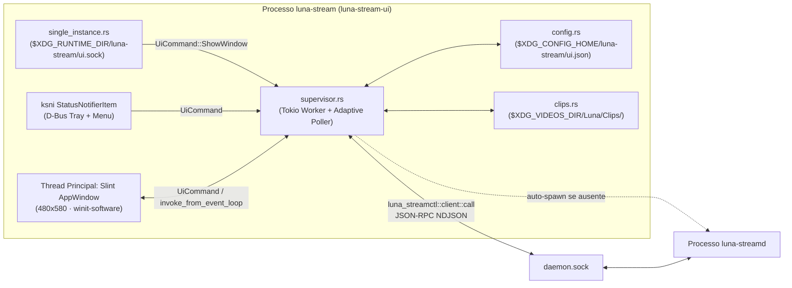

# App Desktop Nativo e Bandeja do Sistema em Slint (`luna-stream-ui`) — Design Document

## 1. Visão Geral, Propósito e Critérios de Sucesso

Este documento especifica o aplicativo desktop nativo do Luna Stream (`crates/luna-stream-ui`, binário `luna-stream`), construído em Rust com **Slint** e **`ksni`**, eliminando a necessidade do Electron para captura, gravação contínua, Replay Buffer em RAM (`ALT+F10`) e gerenciamento local de clipes no Linux.

### Entendimento Compartilhado e Escopo

- **Para quem e por quê:** Usuários da Luna no Linux que querem deixar o app aberto o dia inteiro na bandeja do sistema enquanto jogam, salvando clipes instantâneos ou gravando a tela sem pagar o custo de ~300 MB de RAM e processos Chromium do Electron.
- **Relação com o Roadmap:** Resolve antecipadamente o [ADR-0003](../../adr/0003-toolkit-ui-nativa-slint.md) e entrega a fundação local de bandeja + painel nativo prevista no M7 para os recursos já prontos do motor (M1–M4).
- **Critérios objetivos de sucesso:**
  1. **Consumo ocioso:** `< 30 MB` de RAM RSS, `~0%` de CPU quando recolhido na bandeja e `0 MB` de VRAM na GPU por padrão (`winit-software`).
  2. **Autonomia completa sem CLI:** O usuário abre `luna-stream`, que sobe `luna-streamd` automaticamente se necessário, liga/desliga Replay Buffer, salva clipes (`ALT+F10` ou clique), inicia/para gravações, assiste aos clipes salvos e altera preferências persistentes.
  3. **Ciclo de vida de bandeja:** Fechar a janela (`X`) apenas oculta a janela para a bandeja sem interromper gravação ou replay ativos; abrir `luna-stream` uma segunda vez traz a janela existente para frente (instância única); clicar em *Sair* na bandeja finaliza sessões ativas com segurança e encerra o app.
  4. **Conformidade de licença:** 100% compatível com o [ADR-0001](../../adr/0001-licenca-mit.md) (MIT, zero código GPL).

### Fora de Escopo neste Ciclo

- Transmissão WebRTC/LiveKit, login com conta Luna e palco de visualização de streams de terceiros (dependem do M6 — Transmissão nativa).
- Recorte/edição de início e fim de clipes ou upload para nuvem (M10+).
- Port para Windows (M9 — a arquitetura já isola bandeja e caminhos por plataforma, mas a implementação atual foca no Linux).

---

## 2. Licenciamento e Conformidade ([ADR-0001](../../adr/0001-licenca-mit.md) & [ADR-0003](../../adr/0003-toolkit-ui-nativa-slint.md))

- **Slint (`1.18.x`):** Triplo-licenciado (`GPL-3.0-only OR LicenseRef-Slint-Royalty-free-2.0 OR LicenseRef-Slint-Software-3.0`). Adotado **estritamente sob `LicenseRef-Slint-Royalty-free-2.0`**, que permite distribuição gratuita tanto no repositório MIT quanto em produtos fechados da Luna, mediante atribuição visível na interface.
- **Requisito obrigatório na UI:** Na aba *Ajustes* (seção *Sobre*), exibir de forma legível `"Interface construída com Slint"` acompanhado de ação que abre `https://slint.dev` via `xdg-open`. Um teste automatizado de UI garantirá que esse elemento não seja removido acidentalmente em refatorações futuras.
- **Bandeja (`ksni 0.3.x`):** Licenciado sob `Unlicense` (domínio público), implementando `org.kde.StatusNotifierItem` via D-Bus puro (`zbus`/`tokio`) sem dependências C/GTK.
- **MSRV do Workspace:** Como `slint 1.18` exige `rust-version = "1.92"`, o campo `rust-version` em `[workspace.package]` no `Cargo.toml` raiz será atualizado de `"1.85"` para `"1.92"` (compatível com a toolchain `stable` em uso local e no GitHub Actions).

---

## 3. Arquitetura e Reúso entre Crates (`reuse-first`)

### 3.1 Melhoria Direcionada no Código Existente: `luna-stream-proto::paths`

Hoje a resolução do socket (`daemon.sock`) está duplicada entre `luna-streamd/src/socket.rs` e `luna-streamctl/src/main.rs`, e o cálculo de `$XDG_VIDEOS_DIR/Luna` vive em `luna-streamd/src/naming.rs` (que puxa GStreamer e PipeWire). Para evitar uma terceira cópia em `luna-stream-ui`, extrairemos um módulo puro `std` em `crates/luna-stream-proto/src/paths.rs`:

- `runtime_subdir(runtime_dir: Option<&OsStr>) -> Option<PathBuf>` → `$XDG_RUNTIME_DIR/luna-stream`
- `daemon_socket_path(runtime_dir: Option<&OsStr>) -> Option<PathBuf>` → `$XDG_RUNTIME_DIR/luna-stream/daemon.sock`
- `ui_socket_path(runtime_dir: Option<&OsStr>) -> Option<PathBuf>` → `$XDG_RUNTIME_DIR/luna-stream/ui.sock`
- `default_recordings_dir() -> PathBuf` → `$XDG_VIDEOS_DIR/Luna`, ou `~/Vídeos/Luna` (se `~/Vídeos` existir), ou `~/Videos/Luna`, ou `std::env::temp_dir().join("Luna")`
- `default_clips_dir() -> PathBuf` → `default_recordings_dir().join("Clips")`
- `default_config_dir() -> PathBuf` → `$XDG_CONFIG_HOME/luna-stream`, ou `~/.config/luna-stream`, ou `std::env::temp_dir().join("luna-stream-config")`

`luna-streamd` e `luna-streamctl` passarão a delegar para `luna_stream_proto::paths`, mantendo uma única fonte da verdade em todo o workspace.

### 3.2 Reúso Direto do Cliente IPC

`crates/luna-streamctl` já expõe `pub mod client` com `call(socket_path, method, params) -> Result<Value, ClientError>`. O `luna-stream-ui` dependerá de `luna-streamctl` como biblioteca para reutilizar integralmente o framing NDJSON e tratamento de erros de transporte, sem duplicar código de socket cliente. Nenhum método novo precisa ser adicionado ao protocolo IPC: `daemon.ping`, `encoder.list`, `replay.{start,save,status,stop}` e `record.{start,status,stop}` já cobrem 100% das operações.

---

## 4. Componentes de `crates/luna-stream-ui`

Cada arquivo possui responsabilidade única e fronteira clara de teste:

### 4.1 `main.rs` — Inicialização e Ciclo de Vida
- Aceita flag opcional `--minimized` para iniciar direto na bandeja em login automático do sistema. A janela inicia oculta na bandeja quando `(--minimized || prefs.start_minimized) && tray_available`; se não houver bandeja ativa no ambiente gráfico, a janela abre visível obrigatoriamente.
- Se a variável de ambiente `SLINT_BACKEND` não estiver definida pelo usuário, define `winit-software` antes de inicializar a janela, garantindo `0 MB` de consumo de VRAM na GPU.
- Verifica `single_instance::acquire_or_notify()`: se outra instância já estiver ativa, envia `"show\n"` e encerra com código `0`.
- Inicia um runtime `tokio` em thread dedicada (`Builder::new_multi_thread().worker_threads(2)`), sobe o serviço de bandeja (`tray.rs`), instancia o `AppWindow` Slint e conecta callbacks da UI ao canal `mpsc::UnboundedSender<UiCommand>`.
- Intercepta `window().on_close_requested`:
  - Se a bandeja do sistema estiver ativa (`tray_available == true`), retorna `slint::CloseRequestResponse::HideWindow` e notifica `UiCommand::WindowVisibilityChanged(false)`.
  - **Salvaguarda para ambientes sem bandeja:** Se o D-Bus `StatusNotifierWatcher` não existir no ambiente gráfico do usuário (ex.: WM minimalista sem barra), `tray_available` é `false`; nesse caso, clicar no `X` dispara o encerramento limpo (`UiCommand::Quit`) para nunca prender o usuário com uma janela invisível sem ícone de retorno.

### 4.2 `single_instance.rs` — Instância Única por Usuário
- Opera sobre `ui_socket_path` (`$XDG_RUNTIME_DIR/luna-stream/ui.sock`), garantindo diretório pai com permissão `0700`.
- Se `UnixStream::connect` tiver sucesso, escreve `b"show\n"` e retorna `InstanceRole::SecondaryNotified`.
- Se a conexão falhar (socket órfão de crash anterior) ou o arquivo não existir, remove o arquivo residual, faz `bind` com permissão `0600` e inicia uma tarefa Tokio que lê linhas e envia `UiCommand::ShowWindow` ao supervisor.

### 4.3 `config.rs` — Preferências Persistentes (`UiPreferences`)
- Armazenado em `$XDG_CONFIG_HOME/luna-stream/ui.json` com escrita atômica (`ui.json.tmp` com modo `0600` + `fs::rename`) em diretório `0700`.
- Caso o arquivo não exista ou contenha JSON inválido/corrompido, retorna `UiPreferences::default()` e registra `tracing::warn!`, sem impedir a abertura do app.
- **Campos e valores padrão:**
  - `replay_duration_secs: u32` — padrão `30` (opções na UI: `15`, `30`, `60`, `120`, `300`)
  - `replay_max_ram_mb: u32` — padrão `512` (opções na UI: `256`, `512`, `1024`)
  - `format: ContainerFormat` — padrão `Mp4` (`Mp4` | `Mkv`)
  - `quality: QualityPreset` — padrão `High` (`Ultra` | `High` | `Medium` | `Low`)
  - `fps: u32` — padrão `60` (`30` | `60`)
  - `audio_game: bool` — padrão `true`
  - `audio_call: bool` — padrão `true`
  - `audio_mic: bool` — padrão `true`
  - `clear_after_save: bool` — padrão `false`
  - `start_minimized: bool` — padrão `false`
- Expõe conversores puros:
  - `to_replay_start_params(&self) -> ReplayStartParams`
  - `to_replay_save_params(&self) -> ReplaySaveParams`
  - `to_record_start_params(&self) -> RecordStartParams`
- Alterações na aba *Ajustes* salvam imediatamente em disco (sem botão burocrático de "Salvar"). Se o Replay Buffer já estiver ligado quando o usuário mudar parâmetros de captura (`duration_secs`, `max_ram_mb`, `quality`, `fps`, `format` ou faixas de áudio), a UI exibe nota contextual sutil `"Reinicie o Replay para aplicar na sessão atual"`.

### 4.4 `supervisor.rs` — Supervisão do `luna-streamd` e Polling Adaptativo
- **Descoberta e Auto-spawn do Motor:**
  1. Tenta `daemon.ping` no `daemon.sock`.
  2. Em caso de `ClientError::NotRunning`, procura o executável `luna-streamd` primeiro no mesmo diretório de `std::env::current_exe()` (suportando `cargo build`/`target/debug` e pacotes portáteis) e depois no `$PATH`.
  3. Inicia `Command::new(bin)` com `stdin/stdout/stderr` em `Stdio::null()`, guarda o `Child` (`spawned_by_ui = true`) e repete `daemon.ping` a cada `100 ms` por até `3 s`.
  4. Assim que conectado, chama `encoder.list` uma vez para obter o encoder selecionado (ex.: `vah264enc (GPU)` ou `x264enc (Software)`).
- **Polling Adaptativo (Meta `~0%` CPU na Bandeja):**
  - **Janela visível (`1000 ms`):** Consulta `replay.status` e `record.status`, calcula textos formatados (`18s / 30s`, `142 MB / 512 MB`, `00:12:45 · 418 MB`) e envia snapshot para a thread Slint via `slint::invoke_from_event_loop` apenas quando o estado difere do anterior. Se um clipe acabou de ser salvo (via botão ou atalho global `ALT+F10` detectado por novo arquivo em `Clips/`), atualiza também a lista de clipes.
  - **Janela oculta na bandeja (`3000 ms`):** Consulta `replay.status` e `record.status` apenas para manter o ícone e os rótulos do menu da bandeja sincronizados (ex.: se o replay parar por erro de pipeline), sem disparar atualizações de layout na janela Slint oculta.
- **Encerramento Limpo (`UiCommand::Quit`):**
  1. Remove `ui.sock` e efetiva imediatamente qualquer exclusão de clipe pendente na fila de *Desfazer*.
  2. Se `recording == true`, chama `record.stop` com timeout de `3 s` para garantir gravação íntegra do trailer/EOS.
  3. Se `replay_active == true`, chama `replay.stop` com timeout de `2 s` para liberar o portal `ScreenCast` e o atalho global.
  4. Se `spawned_by_ui == true`, envia `SIGTERM` via `nix::sys::signal::kill` ao PID filho do `luna-streamd` e aguarda até `1 s` antes de encerrar `slint::quit_event_loop()`. (Se o `luna-streamd` já estava rodando externamente antes da UI abrir, o processo externo é preservado.)

### 4.5 `clips.rs` — Leitura Rápida de Clipes e Exclusão com *Desfazer*
- Lê `default_clips_dir()` (`$XDG_VIDEOS_DIR/Luna/Clips/`) sem invocar `ffprobe` nem GStreamer: inspeciona apenas entradas `.mp4` e `.mkv` via `std::fs::read_dir` + `metadata()`.
- Reconhece o padrão gerado pelo motor (`Clip_YYYY-MM-DD_HH-MM-SS_<Jogo>.<ext>`, inclusive sufixos de colisão `_2`, `_3`), extraindo:
  - `game`: nome do jogo limpo (`_` convertido para espaço, ou o nome-base do arquivo caso não siga o prefixo `Clip_`)
  - `recorded_at`: formatado de forma enxuta (`07/11 · 19:42`)
  - `size_label`: tamanho legível (`24,6 MB`)
  - Ordenação decrescente por data de modificação (mais recentes no topo).
- **Ações:**
  - `Assistir`: dispara `Command::new("xdg-open").arg(&clip.path)` desacoplado.
  - `Abrir pasta`: garante existência de `default_clips_dir()` e abre no gerenciador de arquivos via `xdg-open`.
  - `Excluir` com **Fricção Zero (Undo de 6 s):** Em vez de abrir modal bloqueante *"Tem certeza?"*, remover um clipe oculta-o imediatamente da lista em memória e exibe uma barra inline discreta no rodapé da aba (`"Clipe removido"` + botão `"Desfazer"`). Um timer assíncrono de `6 segundos` agenda o `std::fs::remove_file`. Clicar em `"Desfazer"` cancela o timer e restaura o item na posição original; excluir um segundo clipe enquanto há um pendente efetiva o primeiro imediatamente.

### 4.6 `tray.rs` — Bandeja `StatusNotifierItem` (`ksni`)
- Gera em memória ícones `ksni::Icon` ARGB32 (`32×32`, network byte order exigido pela especificação SNI) sem depender de arquivos PNG externos no sistema:
  - **Ocioso (`Idle`):** Círculo/lua estilizada em violeta Luna (`#8B5CF6`) sobre fundo escuro (`#131722`).
  - **Replay Ativo (`ReplayActive`):** Mesmo símbolo com ponto indicador esmeralda (`#10B981`) no canto inferior direito.
  - **Gravando (`Recording`):** Mesmo símbolo com ponto indicador carmesim (`#EF4444`) no canto inferior direito (tem precedência visual quando Replay e Gravação rodam juntos).
- **Menu de contexto (clique direito):**
  1. `Abrir Luna Stream` (traz janela à frente / mostra janela)
  2. `Salvar clipe (Alt+F10)` *(habilitado apenas quando `replay_active && buffered_ms > 0`)*
  3. `Ligar Replay` / `Desligar Replay` *(alterna conforme `replay_active`)*
  4. `Iniciar gravação` / `Parar gravação` *(alterna conforme `recording`)*
  5. `Abrir pasta de clipes`
  6. *(separador)*
  7. `Sair`
- Clique principal (`activate`) no ícone da bandeja alterna visibilidade da janela (mostra e foca se oculta).

---

## 5. Design Visual, Hierarquia e Regras de UX (`ui/*.slint`)

A interface segue rigorosamente os pilares de economia cognitiva e anti-redundância:

### 5.1 Paleta Intencional (Luna Obsidian) e Dimensões
- **Janela:** `480×580 px` padrão (`min-width: 440px`, `min-height: 520px`), título `"Luna Stream"`.
- **Paleta:**
  - `#0B0D13` — Canvas principal profundo
  - `#131722` — Superfície elevada de cartões
  - `#1E2433` — Bordas sutis (`1px`) e estados de hover
  - `#8B5CF6` — Violeta Luna (destaque primário, aba selecionada, controles ativos)
  - `#10B981` — Esmeralda (estado ativo do Replay Buffer e barra de preenchimento)
  - `#EF4444` — Carmesim (gravação ao vivo e alertas de erro)
  - `#F3F4F6` — Texto primário de alto contraste
  - `#9CA3AF` — Metadados e legendas secundárias

### 5.2 Estrutura em 3 Abas (Sem Ecos de Título)

Cabeçalho compacto (`48 px`): marca **Luna** à esquerda + seletor segmentado com 3 abas (`Controle`, `Clipes`, `Ajustes`).

1. **Aba `Controle`** *(nenhum card repete "Controle")*:
   - **Banner de erro inline (condicional):** Visível apenas quando há erro ativo, com mensagem clara em pt-BR e botão `Fechar` discreto.
   - **Card `Replay Buffer`:**
     - Cabeçalho com chave liga/desliga e pílula `Alt+F10` (ou `"Atalho indisponível"` se `hotkey_bound == false` quando ativo).
     - Barra de progresso horizontal mostrando segundos retidos (`28s / 30s`) e memória ocupada (`164 MB / 512 MB`).
     - Botão focal primário de largura total: `Salvar clipe` (muda para `Salvando...` desabilitado durante a escrita, e exibe confirmação breve `"Salvo: Clip_..."` no próprio subtexto do card — canal único de feedback, sem modal nem toast concorrente).
   - **Card `Gravação`:**
     - Estado inativo: resumo rápido do perfil atual (`MP4 · Alta · 60 fps`) e botão `Iniciar gravação`.
     - Estado ativo: indicador pulsante carmesim, cronômetro `HH:MM:SS`, tamanho escrito em `MB` e botão `Parar gravação`.
     - Quando Replay e Gravação estão ativos juntos, pílula informativa discreta: `"Sessão única na GPU"`.
   - **Rodapé técnico enxuto (`28 px`):** Encoder detectado (`vah264enc · GPU`) à esquerda e status do motor (`Motor conectado`) à direita.

2. **Aba `Clipes`** *(sem card externo repetindo "Clipes")*:
   - Barra superior enxuta com contagem (`"12 clipes"`) à esquerda e botão secundário `Abrir pasta` à direita.
   - Estado vazio honesto e direto quando não há arquivos: `"Nenhum clipe salvo em Vídeos/Luna/Clips"` + instrução curta `"Ative o Replay Buffer e pressione Alt+F10 durante o jogo."`
   - Lista rolável (`ScrollView`) de linhas compactas: cada item exibe título do jogo em destaque, data/hora + tamanho abaixo, e ações diretas à direita: `Assistir` e `Excluir` (sem ícones tautológicos colados ao texto).
   - Barra inferior condicional de *Undo* (`"Clipe removido"` · `Desfazer`) visível pelos 6 segundos pós-exclusão.

3. **Aba `Ajustes`** *(seções descem um nível sem repetir "Ajustes")*:
   - **Seção `Buffer de Replay`:** Seletor de duração (`15s`, `30s`, `60s`, `2 min`, `5 min`), limite de RAM (`256 MB`, `512 MB`, `1 GB`) e opção `Limpar buffer após salvar`.
   - **Seção `Vídeo`:** Qualidade (`Ultra`, `Alta`, `Média`, `Baixa`), Formato (`MP4`, `MKV`) e Taxa de quadros (`60 fps`, `30 fps`).
   - **Seção `Faixas de Áudio`:** Chaves independentes `Áudio do jogo`, `Voz (Discord / Call)` e `Microfone`.
   - **Seção `Sistema & Sobre`:** Chave `Iniciar recolhido na bandeja` e rodapé de conformidade obrigatória: `"Luna Stream v0.5.0 · Interface construída com Slint"` com link clicável `slint.dev`.

---

## 6. Tratamento de Erros e Casos de Borda

| Situação / Código IPC | Comportamento na UI (Canal Único Inline) |
|---|---|
| `luna-streamd` não encontrado no disco/`$PATH` | Banner inline: `"Motor luna-streamd não encontrado. Verifique a instalação."` Controles de captura ficam desabilitados até reconexão. |
| `1005` (`PermissionDenied` no portal Wayland) | O usuário cancelou a janela de compartilhamento de tela do sistema. Reverte o toggle imediatamente para desligado e exibe: `"Compartilhamento de tela cancelado."` |
| `1006` (`NoEncoder`) | `"Nenhum codificador H.264 compatível foi encontrado no GStreamer."` |
| `1004` (`OutputNotWritable` / falta de espaço) | `"Sem espaço suficiente ou permissão de escrita na pasta Vídeos/Luna."` |
| `1010` (`ReplayEmpty`) | Botão `Salvar clipe` permanece desabilitado enquanto `buffered_ms == 0`; se acionado em condição de corrida, mostra no subtexto: `"Aguarde alguns segundos para preencher o buffer."` |
| Queda inesperada do `luna-streamd` em execução | Poller detecta `ClientError::NotRunning`, zera estados ativos na UI/bandeja, sobe automaticamente uma nova instância de `luna-streamd` e exibe aviso: `"O motor reiniciou inesperadamente. Reative a captura se desejar."` |
| `last_error` preenchido em `record.status` / `replay.status` | Exibe o motivo reportado pelo pipeline no banner inline e sincroniza os botões para o estado parado. |

---

## 7. Estratégia de Testes Automatizados e CI

1. **Testes Unitários em `luna-stream-proto` (`paths.rs`):**
   - Resolução determinística de `daemon_socket_path`, `ui_socket_path`, `default_recordings_dir` (incluindo fallback `Vídeos` pt-BR vs `Videos`), `default_clips_dir` e `default_config_dir`.
2. **Testes Unitários em `luna-stream-ui`:**
   - `config.rs`: valores padrão, serialização/desserialização roundtrip, permissões `0600` em escrita atômica, recuperação graciosa de JSON inválido e conversão para `ReplayStartParams`/`RecordStartParams`.
   - `clips.rs`: parser de nomes `Clip_YYYY-MM-DD_HH-MM-SS_<Jogo>.{mp4,mkv}` (com e sem sufixo `_2`), ordenação decrescente, ciclo de exclusão diferida (`Excluir` → oculta da lista → `Desfazer` restaura sem apagar do disco; e expiração do prazo apaga efetivamente do disco).
   - `single_instance.rs`: primeira instância adquire `ui.sock`, segunda instância detecta socket vivo, envia `"show"` e dispara o evento na primeira instância; limpeza de socket órfão.
   - `tray.rs`: geração dos pixmaps ARGB32 `32×32` nos três estados (`Idle`, `ReplayActive`, `Recording`) e estado habilitado/rótulos dos itens de menu.
3. **Testes de Integração do Supervisor (`tests/supervisor_ipc.rs`):**
   - Servidor Unix JSON-RPC simulado (ou `Daemon` em modo `SourceKind::Test`) validando: `encoder.list`, transição `replay.start` → `replay.status` → `replay.save` → `replay.stop`, `record.start` → `record.stop` e tradução de erros RPC (`PermissionDenied`, `ReplayEmpty`) para mensagens em pt-BR.
4. **Testes Headless da Interface Slint (`tests/ui_headless.rs`):**
   - Usando `i-slint-backend-testing` (sem servidor Wayland/X11, roda 100% no GitHub Actions):
   - Instancia `AppWindow`, valida navegação entre as 3 abas, binding de progresso do Replay Buffer, disparo dos callbacks `toggle-replay`, `save-clip`, `toggle-record`, resposta `HideWindow` ao fechar com bandeja ativa vs encerramento sem bandeja, e **verifica explicitamente que o texto de atribuição `"Interface construída com Slint"` está presente e não vazio** ([ADR-0003](../../adr/0003-toolkit-ui-nativa-slint.md)).
5. **Atualização do CI (`.github/workflows/ci.yml`):**
   - Adicionar pacotes de desenvolvimento leves necessários para compilar `winit`/`femtovg` no Ubuntu 24.04 (`libfontconfig1-dev`, `libxkbcommon-dev`, `libwayland-dev`), mantendo `cargo fmt --all --check`, `cargo clippy --workspace --all-targets -- -D warnings` e `cargo test --workspace` verdes.
