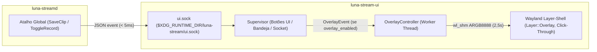

# Especificação de Design — UI Adaptável à Janela e HUD Overlay Rápida (v0.6.1)

- **Data:** 2026-11-08
- **Status:** Em revisão
- **Escopo:** `crates/luna-stream-proto`, `crates/luna-streamd`, `crates/luna-stream-ui`

---

## 1. Visão Geral e Objetivos

Este documento especifica duas evoluções para o aplicativo desktop nativo `luna-stream`:

1. **Adaptação Responsiva ao Tamanho da Janela (`820×540` até `1920×1080+`)**:
   - Permitir que a janela seja redimensionada ou maximizada mantendo proporções sólidas, sem esticar cards de controle verticalmente e aproveitando a largura extra na aba **Home** para exibir dinamicamente mais colunas de capturas recentes (de 3 até 6 colunas).
2. **HUD Overlay Rápida (In-Game / Desktop)**:
   - Exibir um aviso visual compacto (`280×56 px`) no canto superior direito da tela por **2,5 segundos** ao **iniciar/parar Replay**, **iniciar/parar Gravação** e **salvar Clipe** (tanto pelos botões da UI/bandeja quanto pelos atalhos globais dentro de jogos).
   - Garantir que a overlay apareça sobre jogos em tela cheia no Wayland, **nunca roube foco de teclado/mouse**, seja **100% vazada para cliques (*click-through*)**, consuma **0 MB de VRAM** e siga estritamente a identidade visual plana da Luna (`#141414`, sem degradês, sem animações piscantes, com o ícone oficial do `luna-share`).

---

## 2. Arquitetura de Responsividade da Janela

### 2.1 Aba Home (`crates/luna-stream-ui/ui/home_tab.slint`)
- **Seção Superior (Cards de Replay e Gravação)**:
  - Ambos os cards mantêm `horizontal-stretch: 1` (divisão `50% / 50%` da largura útil) e **altura travada** em `height: 210px; vertical-stretch: 0;`.
  - Isso garante que os controles, barras de progresso e botões nunca fiquem espalhados verticalmente em monitores grandes.
- **Seção Inferior (Quadro de Capturas Recentes)**:
  - O `LunaCard` externo de Capturas Recentes recebe `vertical-stretch: 1`, preenchendo de forma limpa a área inferior da janela quando redimensionada.
  - O layout interno das miniaturas mantém `alignment: start` na vertical e na horizontal, preservando o tamanho fixo de cada card individual em **`220×185 px`** (miniatura 16:9 de `204×115 px`).
- **Cálculo Dinâmico de Colunas**:
  - `AppWindow` (`app.slint`) passa a propriedade `available-width: root.width - 200px` para `HomeTab`.
  - O número de colunas visíveis (`visible-cols`) é calculado dinamicamente na `HomeTab`:
    ```slint
    property <int> usable-grid-width: (root.available-width - 64px) / 1px;
    property <int> visible-cols: Math.clamp(Math.floor((usable-grid-width + 14) / 234), 3, 6);
    ```
    - Largura padrão (`920 px` -> `720 px` úteis): **3 colunas**.
    - Largura média (`~1160 px`): **4 colunas**.
    - Largura ampla (`~1400 px`): **5 colunas**.
    - Tela cheia (`1640 px` a `1920 px+`): **6 colunas**.
  - O `supervisor.rs` passa até **6 itens recentes** (`gallery_mgr.recent_items(6)`), e o `for item[idx] in root.recent-items` renderiza apenas os itens com `idx < root.visible-cols`.

### 2.2 Aba Galeria (`crates/luna-stream-ui/ui/gallery_tab.slint`)
- Mantém `vertical-stretch: 1` na `ListView`, adaptando-se integralmente à largura e à altura da janela.

### 2.3 Aba Ajustes (`crates/luna-stream-ui/ui/settings_tab.slint`)
- Os cartões dentro do `ScrollView` recebem `max-width: 860px` alinhados à esquerda (`alignment: start`), evitando que os seletores e botões de ação fiquem excessivamente distantes dos rótulos em telas ultrawide ou 1080p maximizadas.

---

## 3. Arquitetura da HUD Overlay Rápida



### 3.1 Eventos e Conteúdo da Overlay

| Evento (`OverlayKind`) | Cor Lateral (`3 px`) | Título (`13 px Bold`) | Subtítulo (`11 px #A0A0A0`) |
|---|---|---|---|
| `ReplayStarted` | `#22C55E` (Verde) | `Replay ativado` | `Buffer de <N>s ativo` |
| `ReplayStopped` | `#A0A0A0` (Cinza) | `Replay desativado` | `Buffer encerrado` |
| `ClipSaved` | `#EB4141` (Vermelho Luna) | `Clipe salvo` | `<nome_do_arquivo.mp4>` |
| `RecordStarted` | `#22C55E` (Verde) | `Gravação iniciada` | `Capturando vídeo e áudio` |
| `RecordStopped` | `#EB4141` (Vermelho Luna) | `Gravação salva` | `<nome_do_arquivo.mp4>` |

### 3.2 Layout e Identidade Visual
- **Dimensões:** `280×56 px`.
- **Posicionamento:** Canto superior direito (`Anchor::TOP | Anchor::RIGHT`), margem superior de `20 px` e margem direita de `20 px`.
- ** Superfície Plana (Flat):**
  - Fundo sólido `#141414`, borda externa sólida de `1 px` `#2C2C2C`, raio de borda `6 px`.
  - Barra lateral esquerda de `3 px` na cor semântica do evento.
  - Ícone oficial `crates/luna-stream-ui/assets/icon.png` redimensionado para `28×28 px` à esquerda (`x: 14, y: 14`).
  - Título em `#FFFFFF` (`13 px`) na linha superior (`x: 52, y: 12`) e subtítulo em `#A0A0A0` (`11 px`, truncado com reticências se ultrapassar `216 px`) na linha inferior (`x: 52, y: 31`).
  - Zero degradês, zero animações piscantes, zero emojis Unicode.

### 3.3 Renderização Wayland Layer-Shell e Ciclo de Vida (`crates/luna-stream-ui/src/overlay.rs`)
- **Protocolo:** `zwlr_layer_shell_v1` via `smithay-client-toolkit` (já presente na árvore de dependências do workspace):
  - Camada: `Layer::Overlay` (renderiza acima de janelas normais e de jogos em tela cheia no KDE Plasma, Hyprland e Sway).
  - Interatividade de teclado: `KeyboardInteractivity::None` (jamais rouba foco do jogo).
  - *Click-through*: cria uma `wl_region` vazia (`compositor.wl_compositor().create_region()`) e aplica via `wl_surface.set_input_region(Some(&empty_region))`, garantindo que 100% dos cliques e movimentos de mouse atravessem a overlay direto para o jogo.
- **Renderização 100% CPU (`0 MB VRAM`)**:
  - Desenha em buffer `wl_shm` (`wl_shm::Format::Argb8888`) usando `tiny-skia` para o card/bordas, `png` para decodificar `assets/icon.png` (em cache na memória na inicialização da thread) e `ab_glyph` + `fontdb` para renderizar o texto com a fonte sans-serif do sistema.
- **Temporização e Economia de Recursos**:
  - Quando nenhum aviso está ativo, nenhuma `LayerSurface` fica mapeada na tela (0% CPU/GPU).
  - Ao receber um `OverlayEvent`, a worker thread mapeia a superfície, desenha o frame e agenda o fechamento para `Instant::now() + Duration::from_millis(2500)`.
  - Se um novo `OverlayEvent` chegar antes dos 2,5 segundos expirarem, o conteúdo é atualizado imediatamente na mesma superfície e o prazo de 2,5 segundos é renovado.
  - Ao expirar os 2,5 segundos, a `LayerSurface` é destruída e o `wl_display` é sincronizado (`roundtrip`), liberando a superfície até o próximo evento.
- **Fallback gracioso**:
  - Se a conexão Wayland ou o protocolo `zwlr_layer_shell_v1` não estiver disponível (ex: sessão X11 pura ou ambiente headless de teste), o `OverlayController` opera em modo no-op/log sem causar pânico ou falha na aplicação.

### 3.4 Comunicação Instantânea Motor -> UI (`ui.sock`)
- O arquivo `crates/luna-stream-ui/src/single_instance.rs` gerencia o socket `$XDG_RUNTIME_DIR/luna-stream/ui.sock`.
- O protocolo de linha no `ui.sock` passa a suportar dois comandos:
  1. `show\n` -> Abre e foca a janela principal (`UiIncomingEvent::ShowWindow`).
  2. `overlay:<json>\n` -> Dispara imediatamente a HUD Overlay (`UiIncomingEvent::Overlay(OverlayEvent)`).
- Em `crates/luna-streamd/src/hotkey.rs`, as funções `notify_clip_saved` e `notify_recording_state` enviam, além da notificação D-Bus existente, a linha `overlay:<json>\n` para `luna_stream_proto::paths::ui_socket_path()` com timeout de `100 ms`.
- Em `crates/luna-stream-ui/src/supervisor.rs`:
  - Ações iniciadas pela própria UI ou Bandeja (`ToggleReplay`, `SaveClip`, `ToggleRecord`) acionam diretamente o `OverlayController` assim que o motor confirma o sucesso da operação RPC.
  - Para evitar disparo duplo quando um atalho global é usado, o `luna-streamd` envia o evento pelo `ui.sock` apenas nos disparos de atalho global (`trigger_hotkey_action`), enquanto o `supervisor` dispara nos comandos originados pelo usuário na UI/Bandeja.

### 3.5 Configuração e Persistência (`crates/luna-stream-ui/src/config.rs`)
- Adicionado campo `pub overlay_enabled: bool` em `UiPreferences` com `#[serde(default = "default_true")]` (padrão `true`).
- Na aba **Ajustes** (`settings_tab.slint`), adicionado seletor na seção de Atalhos / Geral:
  - **Overlay Rápida na Tela**: `[Ativada] [Desativada]`.

---

## 4. Tratamento de Erros e Testes

1. **Testes Unitários de Responsividade e Preferências**:
   - Teste em `tests/config.rs` garantindo que `overlay_enabled` tem padrão `true` em migrações de JSONs v0.5.0/v0.6.0 e persiste corretamente ao ser desativado.
   - Teste em `tests/ui_headless.rs` validando o cálculo de colunas dinâmicas (`visible-cols` = 3 em `920 px`, 4 em `1160 px`, 6 em `1920 px`) e o binding da preferência `pref-overlay-enabled`.
2. **Testes de IPC do `ui.sock` e Renderizador de Frame da Overlay**:
   - Teste em `tests/single_instance.rs` verificando a recepção concorrente de `"show\n"` e `"overlay:{...}\n"`.
   - Teste unitário do renderizador de pixels da overlay (`render_overlay_frame`) validando que gera um buffer ARGB8888 de `280×56` não-vazio com as cores exatas do tema Luna (`#141414`, barra lateral `#EB4141`/`#22C55E`) sem depender de servidor gráfico ativo.
