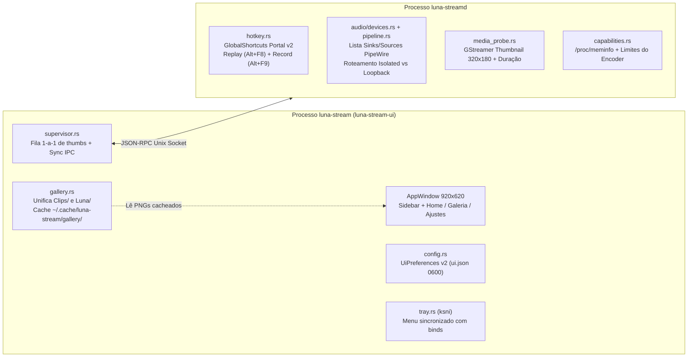

# Evolução da UI Desktop Slint v2 (`Home`, `Galeria`, `Ajustes` e Motor) — Design Document

## 1. Visão Geral, Propósito e Critérios de Sucesso

Este documento especifica a evolução do aplicativo desktop nativo do Luna Stream (`crates/luna-stream-ui`, `crates/luna-stream-proto` e `crates/luna-streamd`), substituindo o layout compacto inicial de diagnóstico por uma experiência desktop completa (`920×620 px`) voltada ao usuário final gamer, mantendo a leveza fora do Electron.

### Entendimento Compartilhado e Regras Visuais Estritas

1. **Identidade Visual Canônica (Padrão Site Luna):**
   - Cores **100% sólidas e planas**: fundo principal `#141414`, barra lateral `#171717`, superfícies de cartões `#1A1A1A`, superfícies elevadas `#222222`, bordas `#2C2C2C` (ativas `#3A3A3A`), destaque/accent `#EB4141` (hover `#F55A5A`), indicador de replay ativo `#10B981`, texto primário `#F5F5F5` e secundário `#A0A0A0`.
   - **Proibições visuais absolutas:** zero degradês (gradientes), zero luzes/indicadores piscando ou animações em loop contínuo, zero emojis Unicode (apenas ícones vetoriais limpos em `Path` estilo Lucide) e zero jargão de engenharia na interface principal (nomes internos como `vah264enc` não aparecem para o usuário).
2. **Três Telas Principais na Navegação Lateral:**
   - **`Home`** (antiga *Controle*): cartões `Replay` (atalho padrão editável `Alt + F8`) e `Gravação` (atalho padrão editável `Alt + F9`), acompanhados da faixa de capturas recentes com preview.
   - **`Galeria`** (antiga *Clipes*): biblioteca unificada de **Clipes** e **Gravações de tela**, com indicador visual de tipo, print (`320×180`) como preview em cache, filtros por `Ano`, `Mês`, `Dia`, `Formato` e `Tipo`, ordenação por `Recentes`, `Tamanho` e `Duração` (`Crescente`/`Decrescente`) e **confirmação dupla inline** para excluir.
   - **`Ajustes`**: campos numéricos livres para **Duração do Replay (s)**, **Bitrate (Kbps)** e **FPS** respeitando os limites reais do hardware/RAM, seletor de **Resolução**, seção de **Atalhos (Binds)** e controle de **Áudio** com modos **`Somente jogo`** (isolado puro, sem mic/call) vs **`Áudio do sistema`** (jogo + mic + call + desktop) com seleção real de **Fone/Saída** e **Microfone**.
3. **Orçamento de Recursos e Segurança na Máquina:**
   - UI permanece em `SLINT_BACKEND=winit-software` (`0 MB` de VRAM, `< 30 MB` de RAM ociosa na bandeja, `0%` de CPU sem timers visuais).
   - Extração de prints e durações roda em **fila sequencial única (`1` vídeo por vez)** no `luna-streamd`.
   - Compilações e execuções de testes durante o desenvolvimento usam `-j 2` e `--test-threads 1` para nunca sobrecarregar o PC.
   - Conformidade integral mantida com [ADR-0001](../../adr/0001-licenca-mit.md) (MIT) e [ADR-0003](../../adr/0003-toolkit-ui-nativa-slint.md) (atribuição visível `"Interface construída com Slint"` em *Ajustes*).

---

## 2. Arquitetura e Expansão entre Crates (`reuse-first`)

### 2.1. Novos Métodos e Tipos em `luna-stream-proto`

- **`paths::default_cache_dir() -> PathBuf`:** resolve `$XDG_CACHE_HOME/luna-stream` ou `~/.cache/luna-stream`.
- **Métodos JSON-RPC adicionados em `methods`:**
  1. `system.capabilities` (`SYSTEM_CAPABILITIES`) → retorna `SystemCapabilitiesResult`:
     - `total_ram_mb: u64`
     - `max_buffer_ram_mb: u32` (`50%` da RAM total lida de `/proc/meminfo`, mínimo `128 MB`, teto `32768 MB`)
     - `max_bitrate_kbps: u32` (`150_000` para encoder hardware; `50_000` para software)
     - `min_bitrate_kbps: u32` (`1_000`)
     - `max_fps: u32` (`240`), `min_fps: u32` (`15`)
     - `max_replay_secs: u32` (`1_800`)
     - `encoder_kind: Option<EncoderKind>`
  2. `audio.devices` (`AUDIO_DEVICES`) → retorna `AudioDevicesResult`:
     - `inputs: Vec<AudioDeviceEntry>` (`id`: `node.name`, `label`: `node.description` ou `node.nick`)
     - `outputs: Vec<AudioDeviceEntry>` (`id`: `node.name`, `label`: `node.description`, excluindo nós internos `luna_game` e `luna_call`)
  3. `hotkeys.configure` (`HOTKEYS_CONFIGURE`) → recebe `HotkeysConfigureParams`:
     - `replay_trigger: String` (padrão `"ALT+F8"`)
     - `record_trigger: String` (padrão `"ALT+F9"`)
     - `record_defaults: RecordStartParams` (parâmetros usados quando `Alt + F9` inicia gravação direto do jogo)
     - Retorna `HotkeysConfigureResult { replay_bound: bool, replay_trigger: String, record_bound: bool, record_trigger: String }`.
  4. `media.inspect` (`MEDIA_INSPECT`) → recebe `MediaInspectParams { path: PathBuf, thumb_output: PathBuf }` e retorna `MediaInspectResult { duration_ms: u64, thumb_written: bool }`.
- **Extensão de `AudioConfig` e `ReplayStartParams`:**
  - `AudioConfig` recebe `#[serde(default, skip_serializing_if = "Option::is_none")] pub output_device: Option<String>`.
  - `ReplayStartParams::validate` amplia `duration_secs` para `5..=1800` e `fps` para `15..=240`.

---

## 3. Comportamento no Motor (`luna-streamd`)

### 3.1. Gerenciador Global de Atalhos (`hotkey.rs` + `session.rs`)
- Em vez de existir apenas enquanto o Replay está ligado, o gerenciador de atalhos fica hospedado no `SessionManager` durante toda a vida do daemon.
- Registra simultaneamente dois atalhos no portal `org.freedesktop.portal.GlobalShortcuts`:
  - **Salvar Replay:** ID versionado pelo slug do gatilho (`save_clip_<slug>`) para que edições feitas pelo usuário em `ui.json` apliquem o novo `preferred_trigger` imediatamente no KDE Wayland sem exigir janelas externas. Quando acionado com Replay ativo e buffer não vazio, salva o clipe e dispara notificação desktop.
  - **Alternar Gravação:** ID `toggle_record_<slug>` (`ALT+F9` padrão). Se uma gravação estiver ativa, executa `stop_recording` e notifica; se estiver parada, executa `start_recording` usando `record_defaults` configurados pela UI.

### 3.2. Roteamento de Áudio e Seleção de Fone / Microfone (`audio/` + `pipeline.rs`)
- **Enumeração (`audio.devices`):** reutiliza o parser JSON de `pw-dump` já existente em `audio/router.rs`, extraindo `node.description` / `media.name` para `Audio/Source` (microfones) e `Audio/Sink` (fones/saídas), ignorando `luna_game` e `luna_call`.
- **Aplicação no Pipeline GStreamer (`pipeline.rs`):**
  - **Modo `Somente jogo` (`SystemAudioMode::Isolated` com `game: true, call: false, microphone: false`):** captura exclusivamente `luna_game.monitor`. Nenhum microfone e nenhuma call/navegador entram no arquivo.
  - **Modo `Áudio do sistema` (`SystemAudioMode::DesktopLoopback`):**
    - Para o áudio do sistema/fone: se `audio.output_device` for `Some(sink_name)`, usa `pulsesrc device="{sink_name}.monitor"`; se `None` (*Padrão do sistema*), usa o `.monitor` do sink padrão resolvido ou `pulsesrc` padrão; se `audio.game == false` (*Fone Desativado*), omite a trilha de sistema.
    - Para o microfone: se `audio.microphone == true`, usa `pulsesrc device="{mic_device}"` (ou padrão do sistema quando `None`).

### 3.3. Extrator Sequencial de Print e Duração (`media_probe.rs`)
- Protegido por um `tokio::sync::Semaphore` de **permissão `1`** (garantindo no máximo 1 decodificação curta por vez).
- Usa GStreamer em estado `PAUSED` (`filesrc ! parsebin/decodebin ! videoconvert ! videoscale ! video/x-raw,width=320,height=180,pixel-aspect-ratio=1/1 ! pngenc`):
  1. Consulta `query_duration::<gst::ClockTime>()` para obter `duration_ms` exato.
  2. Faz `seek_simple` com `KEY_UNIT | SNAP_BEFORE` para `min(1_000 ms, duration_ms / 5)` (evitando fade-in preto do frame zero) e grava 1 único frame PNG atômico em `thumb_output` com timeout máximo de `3s`.

---

## 4. Especificação Detalhada das 3 Telas (`luna-stream-ui`)

### 4.1. Casca da Janela e Sidebar (`ui/app.slint`)
- **Janela:** `preferred-width: 920px; preferred-height: 620px; min-width: 820px; min-height: 540px; background: #141414;`.
- **Sidebar esquerda (`190px`, `#171717`, borda direita `1px #2C2C2C`):**
  - Cabeçalho com marca **Luna** (ícone vetorial plano em `#EB4141` + título) e pílula sólida estática de estado (`Pronto`, `Replay ativo` em `#10B981`, ou `Gravando` em `#EB4141`).
  - Itens de navegação com ícone vetorial + rótulo e filete lateral esquerdo de `3px` em `#EB4141` quando selecionado:
    1. **`Home`**
    2. **`Galeria`** (com badge numérica discreta do total de itens)
    3. **`Ajustes`**
  - Rodapé da sidebar com resumo limpo da configuração ativa (`ex.: Nativa · 60 fps · 15000 Kbps`).

### 4.2. Tela 1 — `Home` (`ui/home_tab.slint`)
- Banner superior condicional sólido (`#2A1215`, sem piscar) apenas quando houver erro acionável, com botão `Fechar`.
- **Linha principal em 2 colunas iguais (`spacing: 16px`):**
  1. **Card `Replay`:**
     - Cabeçalho: título `Replay`, badge sólida de estado (`Ativo` / `Desligado`) e botão plano `Ativar` / `Desativar`.
     - Corpo: barra de preenchimento plana da janela configurada (ex.: *"Últimos 30s prontos para salvar"*) e linha de atalho com componente clicável **`KeybindBadge`** exibindo `[ Alt + F8 ]`.
     - Rodapé do card: botão primário sólido em `#EB4141` **`Salvar clipe`** (desabilitado enquanto desligado ou salvando) e feedback discreto do último arquivo salvo.
  2. **Card `Gravação`:**
     - Cabeçalho: título `Gravação` e badge sólida (`Gravando` em `#EB4141` ou `Parada`).
     - Corpo: cronômetro tipográfico limpo (`00:00:00 · 0,0 MB` quando gravando, ou resumo `MP4 · Áudio do sistema` quando parada) e linha de atalho com **`KeybindBadge`** exibindo `[ Alt + F9 ]`.
     - Rodapé do card: botão sólido **`Iniciar gravação`** (`#222222` com borda `#3A3A3A`, mudando para **`Parar gravação`** em `#EB4141` quando ativa).
- **Seção inferior — `Capturas recentes`:**
  - Cabeçalho com título `Capturas recentes` e link `Ver Galeria →` (muda `active-tab = 1`).
  - Grade horizontal com os **3 itens mais novos** (sejam clipes ou gravações), mostrando miniatura `16:9`, tag de tipo (`Clipe` / `Gravação`), duração e abertura rápida no clique. Estado vazio limpo caso ainda não existam vídeos.

### 4.3. Componente de Captura de Atalho (`KeybindBadge`)
- Usado tanto na `Home` quanto na seção `Atalhos` de `Ajustes`.
- Ao clicar, assume estado focado sólido (`borda #EB4141`, texto `"Pressione as teclas..."`).
- `Esc` cancela a edição; `Backspace`/`Delete` restaura o padrão (`Alt+F8` ou `Alt+F9`).
- Aceita teclas `F1`–`F12` isoladas ou combinadas com `Alt`/`Ctrl`/`Shift`/`Super`, ou letras/números combinados com pelo menos um modificador (`Alt`, `Ctrl` ou `Super`).
- Converte para formato canônico XDG (`ex.: ALT+F8`, `CTRL+SHIFT+R`) e formato amigável de exibição (`Alt + F8`, `Ctrl + Shift + R`). Se coincidir com o outro atalho, exibe aviso inline *"Atalho já em uso"* e mantém o anterior.

### 4.4. Tela 2 — `Galeria` (`ui/gallery_tab.slint` + `src/gallery.rs`)
- **Modelo unificado (`GalleryItem`):**
  - `path: PathBuf`, `file_name: String`, `title: String`, `kind: MediaKind` (`Clip` | `Recording`), `format: String` (`"MP4"` | `"MKV"`), `year: u16`, `month: u8`, `day: u8`, `date_label: String`, `size_bytes: u64`, `size_label: String`, `duration_ms: u64`, `duration_label: String`, `sort_timestamp_ms: u128`, `thumb_path: Option<PathBuf>`.
- **Barra de Filtros e Ordenação (topo da Galeria):**
  - **Filtros:**
    - `Tipo`: `Todos`, `Clipe`, `Gravação`
    - `Formato`: `Todos`, `MP4`, `MKV`
    - `Ano`: `Todos` + anos presentes no acervo
    - `Mês`: `Todos` + meses presentes (`01` a `12`)
    - `Dia`: `Todos` + dias presentes (`01` a `31`)
    - Botão `Limpar` visível quando qualquer filtro diferir de `Todos`.
  - **Ordenação:**
    - Critério: `Recentes` (`sort_timestamp_ms`), `Tamanho` (`size_bytes`), `Duração` (`duration_ms`).
    - Botão de ordem ao lado: alterna `Decrescente` (padrão) e `Crescente`, exibindo seta vetorial clara (`↓` / `↑`).
- **Grade de Cards (ScrollView em colunas de 3 cards por linha):**
  - **Preview `16:9`:** exibe `Image` carregada do `thumb_path` (ou retângulo sólido `#222222` com ícone vetorial discreto de vídeo enquanto a print é gerada). Sobrepostos em blocos sólidos nos cantos: badge `Clipe` (`#EB4141`) ou `Gravação` (`#222222`), e badge de duração (`00:30`). Clicar na print abre o vídeo.
  - **Metadados e Ações:** título do jogo/gravação, linha `DD/MM/AAAA · HH:MM · 24,6 MB · MP4`, botão `Assistir` e botão `Excluir`.
  - **Confirmação Dupla Inline de Exclusão:**
    - 1º clique em `Excluir` marca `confirming_delete_path = item.path` e troca os botões daquele card específico por **`Confirmar`** (`#EB4141`) + **`Cancelar`** (`#222222`).
    - Clicar em `Cancelar` (ou clicar em `Excluir` de outro card / trocar de aba) desfaz o estado de confirmação sem apagar nada.
    - 2º clique em `Confirmar` remove o arquivo do disco e atualiza a Galeria e a faixa de recentes da Home imediatamente.

### 4.5. Tela 3 — `Ajustes` (`ui/settings_tab.slint` + `src/config.rs`)
Organizada em `ScrollView` limpa com 4 cartões planos:

1. **Card `Captura e Qualidade`:**
   - **Duração do Replay (segundos):** campo numérico editável (`LineEdit` numérico + botões `-`/`+`), validado no intervalo `[5 .. max_secs_for_current_bitrate]`. Exibe legenda dinâmica: *`Limite disponível neste bitrate: Xs · Buffer máx estimado: Y MB`*. O `replay_max_ram_mb` é derivado automaticamente com margem de `25%` até o teto seguro da máquina (`max_buffer_ram_mb`).
   - **Bitrate de Vídeo (`Kbps`):** campo numérico livre em **Kbps** (padrão `15000`, limites `[1000 .. max_bitrate_kbps]` reportados pelo motor).
   - **Taxa de Quadros (`FPS`):** campo numérico livre (padrão `60`, limites `[15 .. 240]`).
   - **Resolução:** botões planos `Nativa`, `1440p`, `1080p`, `720p`.
   - **Formato do arquivo:** `MP4` ou `MKV`.
   - Opção booleana: `Limpar buffer após salvar clipe`.
2. **Card `Áudio`:**
   - **Modo de Captura (seletor plano de 2 opções):**
     - **`Somente jogo`**: legenda curta *"Grava exclusivamente o som isolado do jogo (sem microfone e sem chamadas)"*. Quando ativo, os seletores de Fone e Microfone ficam visualmente desabilitados (`opacity: 0.45`, sem interação) e o IPC envia `SystemAudioMode::Isolated` com `game: true, call: false, microphone: false`.
     - **`Áudio do sistema`**: legenda curta *"Grava jogo, chamadas, sistema e microfone selecionados"*. Quando ativo, habilita os seletores abaixo e envia `SystemAudioMode::DesktopLoopback`.
   - **Fone / Saída:** seletor com `Padrão do sistema`, `Desativado` e todos os `outputs` retornados por `audio.devices`.
   - **Microfone:** seletor com `Padrão do sistema`, `Desativado` e todos os `inputs` retornados por `audio.devices` + botão `Atualizar dispositivos`.
3. **Card `Atalhos`:**
   - Linha `Salvar Replay` com `KeybindBadge` (`Alt + F8` padrão).
   - Linha `Iniciar / parar gravação` com `KeybindBadge` (`Alt + F9` padrão).
   - Botão discreto `Restaurar atalhos padrão`.
4. **Card `Sistema e Sobre`:**
   - Chave `Iniciar minimizado na bandeja`.
   - Rodapé legal obrigatório (`ADR-0003`): `"Luna Stream · Interface construída com Slint"` + link clicável `slint.dev`.

---

## 5. Persistência (`ui.json`), Erros e Estratégia de Testes

- **Migração suave de `ui.json`:** `UiPreferences` usa `#[serde(default)]` em todos os novos campos (`bitrate_kbps = 15_000`, `resolution = ResolutionPreset::Native`, `audio_profile = AudioCaptureProfile::SystemAndMic`, `mic_device = None`, `output_device = None`, `replay_hotkey = "ALT+F8"`, `record_hotkey = "ALT+F9"`), carregando arquivos `ui.json` da v0.5.0 sem erro nem perda de dados.
- **Erros inline em pt-BR:** valores digitados fora do mínimo/máximo sofrem `clamp` seguro ao confirmar o campo (`accepted` / perda de foco) e mostram o limite aplicado sem bloquear o usuário.
- **Testes Automatizados Leves (`-j 2 -- --test-threads 1`):**
  1. `luna-stream-proto`: serialização e validação dos novos métodos IPC e limites estendidos.
  2. `luna-streamd`: teste de `capabilities`, parser de `audio.devices` sobre fixture `pw-dump` e `media_probe` extraindo print PNG `320×180` + `duration_ms` real de vídeo gerado em teste.
  3. `luna-stream-ui`:
     - `gallery`: unificação de `Clips/` + `Luna/`, filtros combinados (`Ano`/`Mês`/`Dia`/`Formato`/`Tipo`), ordenação crescente/decrescente (`Recentes`, `Tamanho`, `Duração`) e fluxo de confirmação dupla de exclusão.
     - `config` & `keybind`: cálculo dinâmico de duração máxima vs RAM/Kbps, migração de `ui.json`, mapeamento `Somente jogo` vs `Áudio do sistema` e validação de conflito entre atalhos.
     - `ui_headless`: instanciação da janela `920×620`, navegação entre `Home` / `Galeria` / `Ajustes`, edição de preferências numéricas, confirmação dupla e verificação da atribuição obrigatória Slint.
